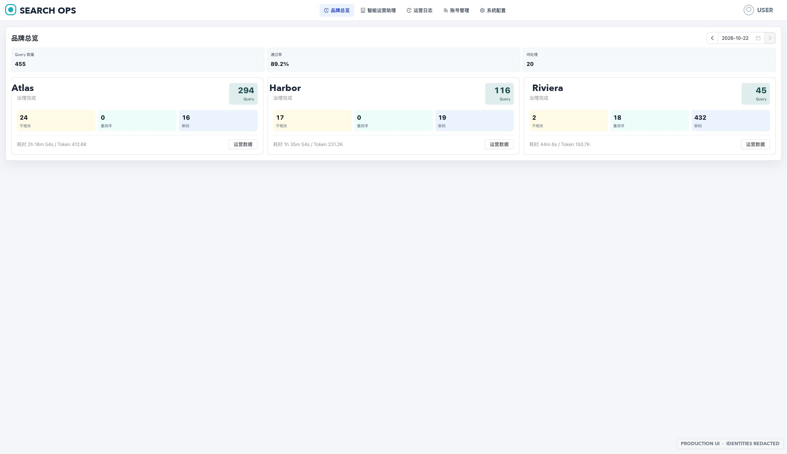
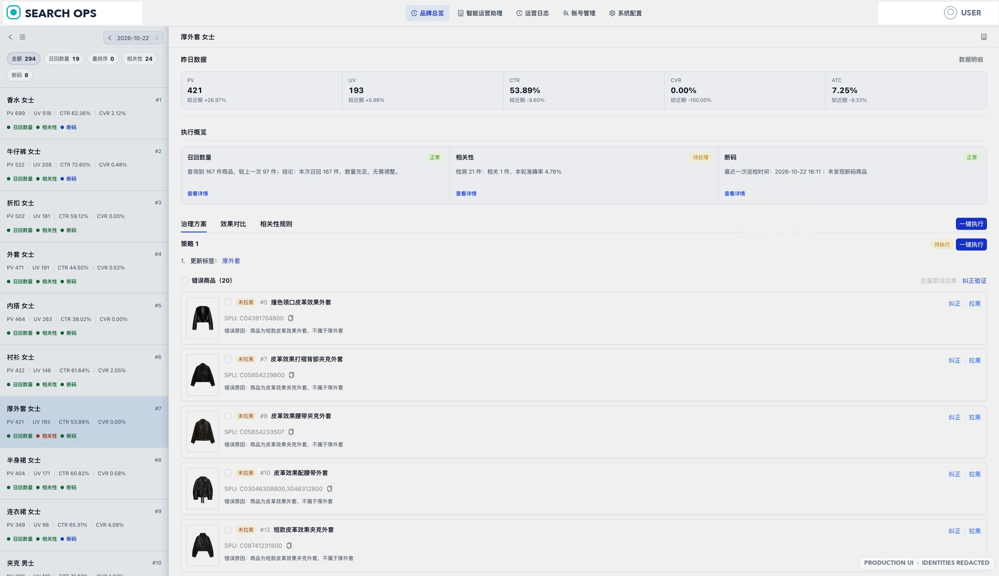
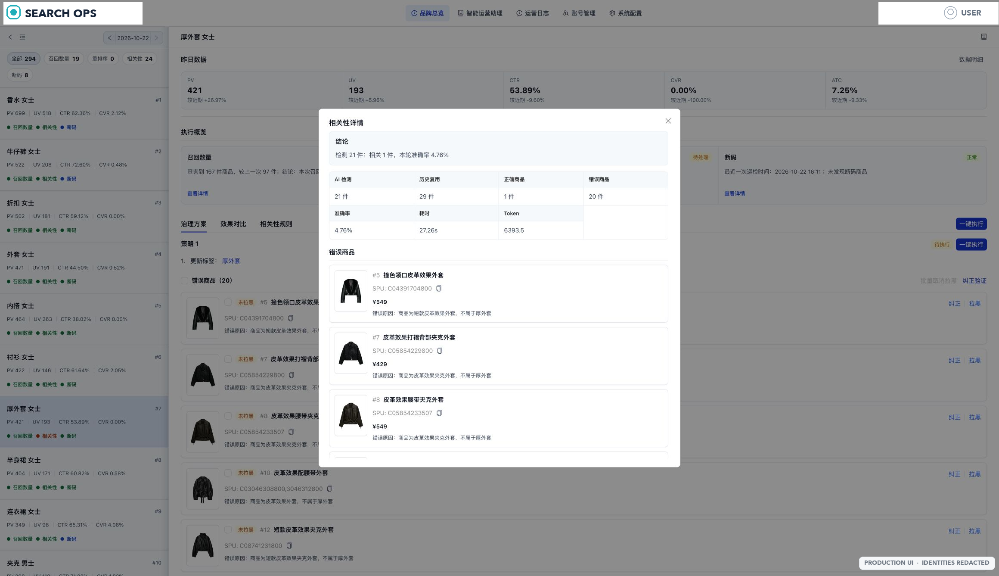
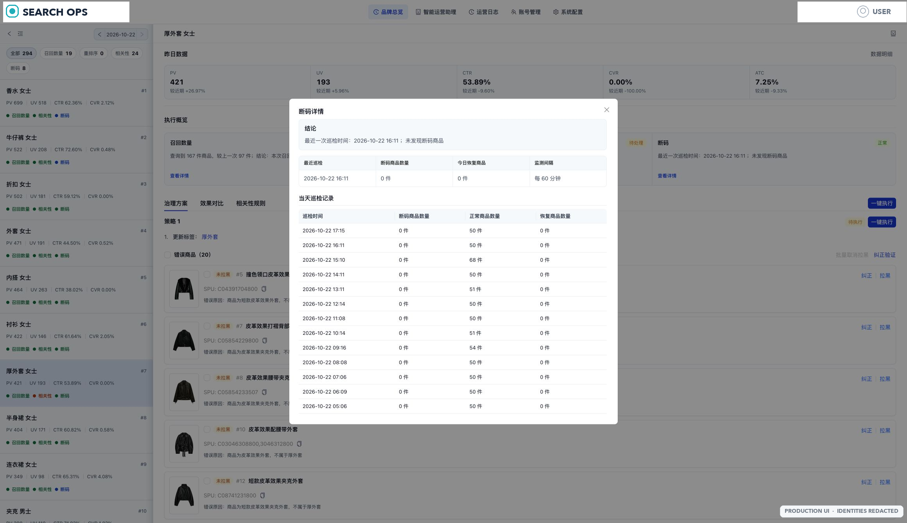

# 搜索结果自动化运维工具 (Search Ops Automation)

[](https://github.com/ZhangGM-China/search-ops-automation)

本项目是一个集 **自动化数据分析**、**AI 智能诊断** 与 **可视化管理终端** 为一体的搜索自动化运维系统。核心目标是自动发现、诊断并治理电商搜索场景中 CTR/CVR 异常的关键词（Query），通过智能化的治理手段（拉黑、降权、恢复）闭环提升搜索质量与用户体验。

---

## 界面预览

以下截图来自生产环境，用于展示真实工作台的信息密度和核心操作链路。品牌名、平台标识和登录账号已遮盖。

| 品牌运营总览 | Query 治理工作台 |
| --- | --- |
|  |  |

| 相关性诊断详情 | 库存断码巡检 |
| --- | --- |
|  |  |

---

## 🌟 核心能力

- **智能发现 (Extractor)**：自动对接生产 RDS/CDB 数据源，基于多品牌指标模型识别昨日表现异常的 Top 搜索词。
- **AI 闭环治理 (LangGraph Workflow)**：
    - **多模态诊断**：利用 AI 视觉与语义模型对商品进行相关性判定，识别“货不对板”（支持针对特定品牌如Summit的深度商品信息富化，以提供更精准的判断上下文）。
    - **深度异常分析**：当自动化动作不适用时，自动触发专业零售背景的 AI Agent 进行全局原因诊断（季节、气温、心理等因素）。
    - **自动化决策**：智能选择 **批量拉黑** 或 **分层降权**，并自动提交至生产搜索服务。
    - **库存动态追踪**：每小时监测库存，自动恢复补货商品的搜索分层。
- **可视化管理终端 (Dashboard)**：
    - **实时监控**：查看每日异常 Query 及其 AI 诊断结论。
    - **详情穿透**：通过“详情”弹窗查看 Query 的基础指标、深度原因分析及可行性治理建议。
    - **人工介入**：支持手动撤销误操作（取消拉黑/取消降权）。
    - **效果追踪**：可视化展示治理后 5 日内的 CTR/CVR 趋势。
- **自动化汇报**：每日 09:00 自动生成深度运维报告，推送至飞书机器人。

---

## 🛠 技术栈

- **后端**: Python 3.10+ / FastAPI / LangGraph / LangChain / SQLAlchemy / APScheduler
- **前端**: React 19 / TypeScript / Vite / Ant Design 6 / Ant Design Charts
- **数据库**: MySQL (生产源) / SQLite (本地持久化与追踪库)
- **部署**: Docker（本地开发）/ TKE（生产）

---

## 📂 目录结构

```text
├── main.py                # 调度器启动入口 (自动化任务)
├── config.yaml            # 核心业务与品牌策略配置
├── .env                   # 敏感信息配置 (API Key, DB URI)
├── src/
│   ├── api/               # FastAPI 应用、路由和应用服务
│   ├── persistence/       # SQLAlchemy 模型、Session 和仓储
│   ├── scheduler/         # 调度、租约、恢复和终止控制
│   ├── query_governance/  # Query 治理主线、A/B 实验和受控运营动作
│   ├── top_query/         # 旧实现，仅作历史参考（不要新增当前主线代码）
│   ├── no_result/         # No Result 治理
│   └── integrations/      # 搜索运营、知识图谱等外部适配
├── frontend/              # 管理后台前端项目 (React)
│   ├── src/app/           # 应用壳、路由和布局
│   ├── src/features/      # 按业务域组织的页面和组件
│   ├── src/shared/        # 跨 Feature 稳定复用代码
│   ├── src/test/          # 架构守卫和跨 Feature 集成测试
│   └── e2e/               # Playwright 浏览器测试
├── scripts/               # 工具脚本 (DB初始化、环境检查)
└── docs/                  # 开发文档与 PRD
```

---

## ⚙️ 快速开始

### 1. 基础环境准备
```bash
# 安装依赖
pip install -r requirements.txt

# 项目测试与后端脚本请统一使用共享虚拟环境入口（独立 Worktree 也适用）
bash scripts/ci/run_python_offline.sh -m pytest tests/

# 复制环境变量模板并填写
cp .env.example .env

# 初始化本地治理库
./venv/bin/python scripts/db/init_local_db.py
```

默认本地测试库为可重建的 `data/local_db/search_ops_automation_test.db`。首次启动时由应用初始化数据库结构；如需使用其他本地库，请通过 `.env` 中的 `AUTO_DB_URI_TEST` 或 `AUTO_DB_URI` 显式覆盖。

### 2. 启动后端服务
后端包含 **调度器**（执行定时任务）和 **API 服务**（供前端展示）。本地开发必须显式使用 `ENV=test`，可以直接使用一键脚本：

```bash
./scripts/start_local.sh
```

需要分别调试 API 和 Scheduler 时，在两个终端执行：

```bash
ENV=test ./venv/bin/python -m uvicorn src.api:app --host 127.0.0.1 --port 8001 --no-access-log
ENV=test ./venv/bin/python main.py
```

API 的 lifespan 会在 test 环境初始化本地治理库；prod 环境只验证发布声明的 schema，验证失败时拒绝启动，不执行隐式迁移。

### 3. 启动前端页面
前端需要单独启动。Query Governance 本地验收请固定使用当前 worktree 的启动脚本，脚本会打印实际 `PROJECT_ROOT / FRONTEND_CWD / VITE_API_BASE`，避免误从主目录旧代码启动：

```bash
./scripts/dev/start_query_governance_frontend.sh
```
访问地址：`http://localhost:5174`

前端测试前先在 `frontend/` 安装锁定依赖：

```bash
cd frontend && npm ci --prefer-offline --no-audit --no-fund
```

`scripts/start_local.sh` 会通过 `scripts/dev/start_query_governance_frontend.sh` 启动前端，不会绕过当前 worktree 的 5174 校验。

前端验收命令：

```bash
./scripts/dev/run_query_governance_frontend_checks.sh
```

测试入口、验证边界和证据层级见 [`docs/TSD/08-联调测试与规范.md`](docs/TSD/08-联调测试与规范.md)。日常提交前推荐先运行：

```bash
ENV=test bash scripts/ci/test_fast.sh
```

---

## 🛠 运行与发布入口

### 1. 生产发布

生产发布、Schema 风险判断、部署、验收和自动回滚只通过统一入口 `scripts/release/release.py` 执行。TKE 使用同一入口下的 `tke-*` 阶段命令，先生成候选，再按指南完成演练、部署、激活和回读：

```bash
python3 scripts/release/release.py --state-dir "$STATE_DIR" tke-candidate \
  --release-sha "$RELEASE_SHA" \
  --schema-release zha33
```

具体授权、候选版本、回读和回滚要求见 `docs/production_deployment_guide.md`。生产回滚仅使用已记录的 TKE 不可变 release；不得手动补表或绕过 `release.py` 启动生产服务。

### 2. 测试环境手动补跑 (Catch-up)
如果例行任务执行失败，或者需要立即拉取 **昨日** 的 Query 进行治理，请调用当前调度入口；旧的 Agent Loop 补跑入口已退役：
```bash
ENV=test ./venv/bin/python -c 'import datetime; from src.scheduler import query_governance_experiment_job; from src.query_governance.composition import build_query_governance_workflow; print(query_governance_experiment_job(target_date=datetime.date.today() - datetime.timedelta(days=1), workflow_factory=build_query_governance_workflow))'
```

不要调用 `agent_loop_governance_job`、`run_agent_loop_rerun.py` 或
`resume_agent_loop_rerun.py`；这些旧入口会明确失败并提示已退役。

### 3. 查看本地运行日志
```bash
# 查看自动化任务进度
tail -f logs/scheduler.log

# 查看接口调用报错
tail -f logs/api.log

# 查看前端开发服务
tail -f logs/frontend.log
```

---

## 📊 核心配置说明

### `config.yaml`
- 只承载系统调度、安全策略、品牌和搜索规则，不决定运行环境。
- `brand_configs`: 针对 Atlas、Meadow 等品牌的差异化提取阈值与治理策略。

### `.env`
- `ENV`: 运行环境唯一来源；缺失或空值默认为 `test`，仅接受 `test`/`prod`，其他值拒绝启动。进程环境变量优先于 `.env`。
- `AUTO_DB_URI_TEST`: 本地治理库连接串。
- `AUTO_DB_URI_PROD`: 生产治理库连接串，仅通过受控 Secret 注入。
- `API_KEY`: 生产运维系统鉴权令牌。
- `FEISHU_WEBHOOK`: 运维日报推送地址。

真实凭据不得写入 README、Git 或 Plane；生产发布仍需独立授权。

---

## 🛡️ 安全与可靠性

- **环境隔离**: 默认工作在 `test` 环境，不影响生产数据，切换 `prod` 需显式授权。
- **自动熔断**: 核心接口连续失败超过阈值（默认10次）将自动停止任务并告警。
- **操作可溯**: 所有 AI 决策与 API 请求均记录在 `operation_log` 与 `automation_action_log` 中。
- **二次验证**: 每次批量提交治理动作后，系统会模拟搜索再次复查，确保治理生效。
