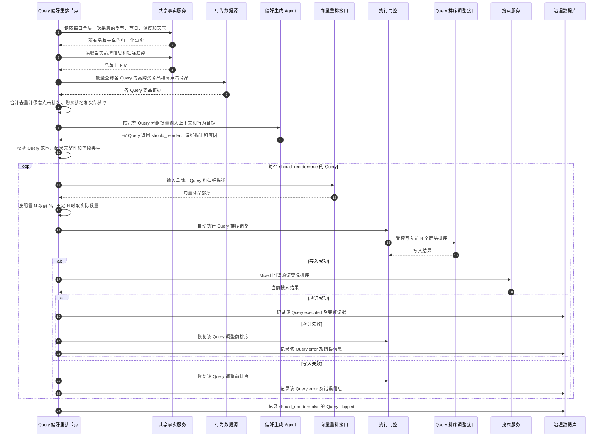
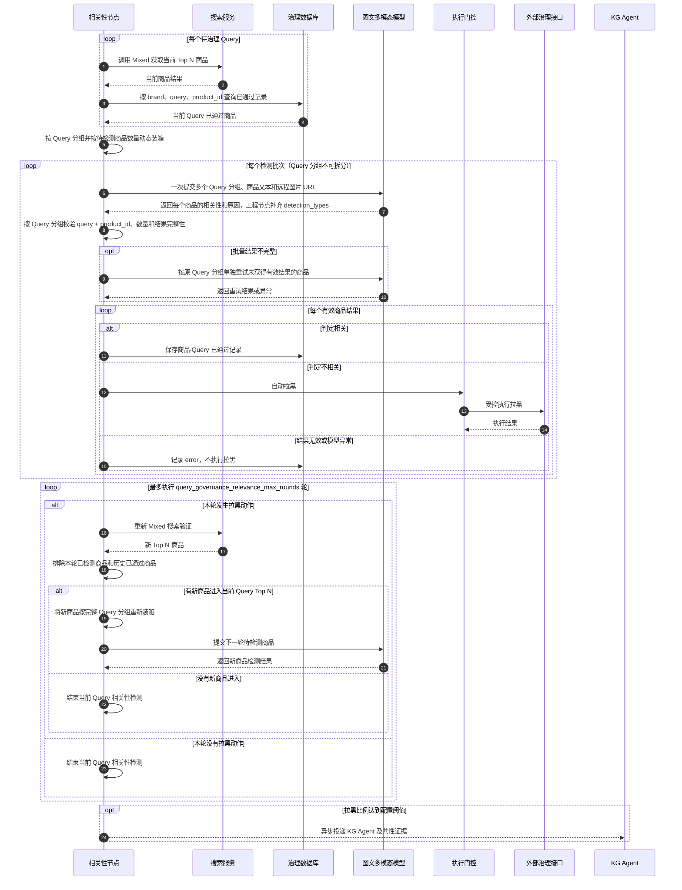
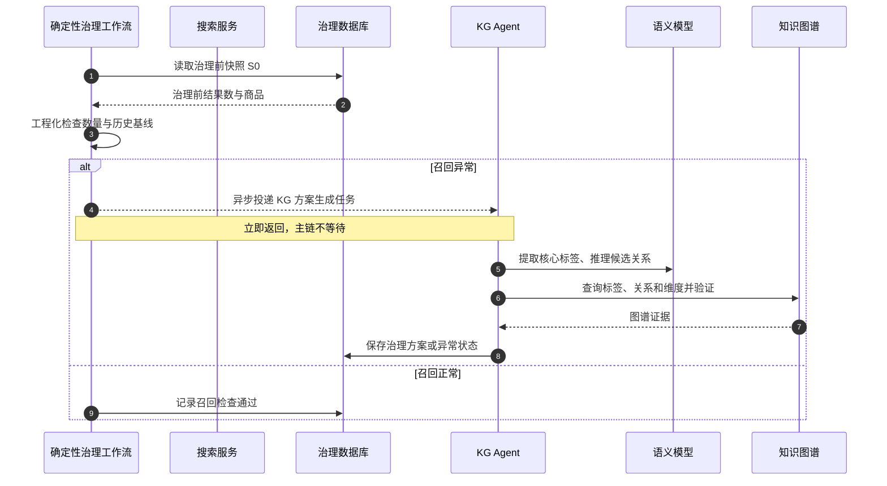
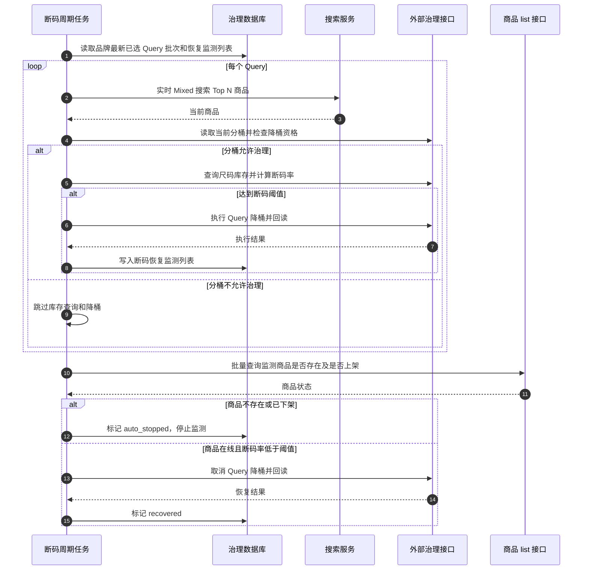
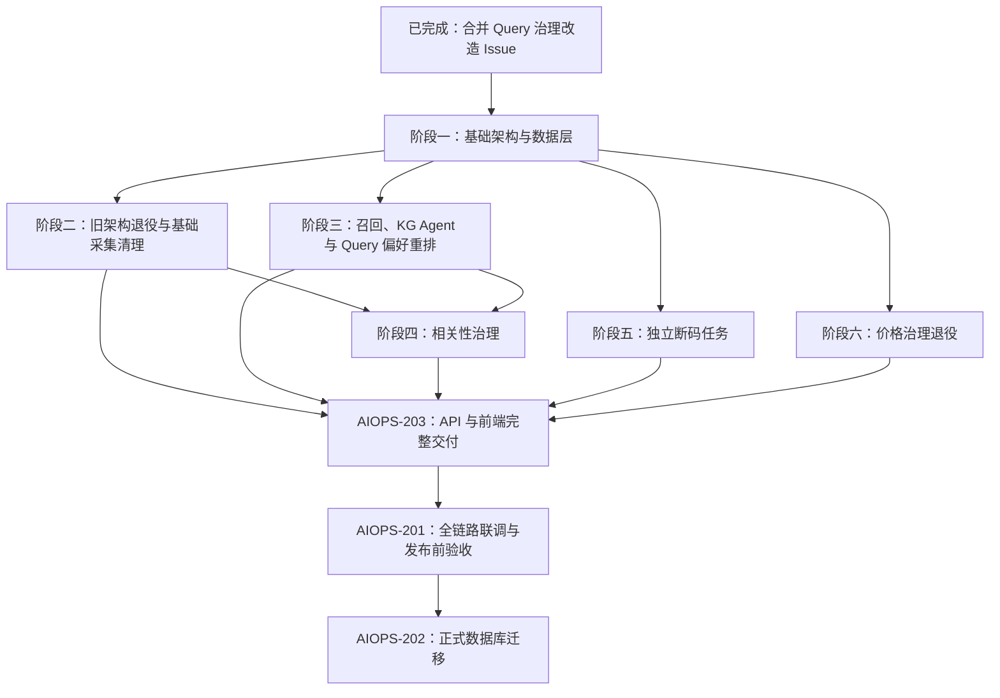
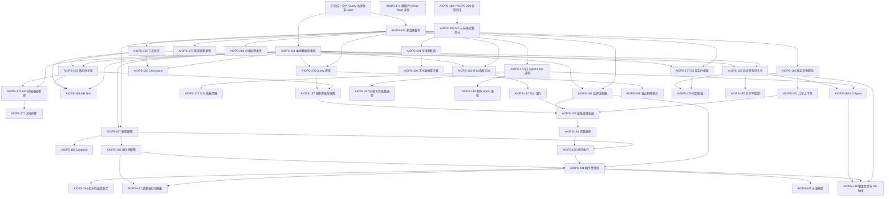

# Query 治理重构计划

| 字段 | 内容 |
| --- | --- |
|  |
| 创建时间 | 2026-08-18 |
| 最后更新时间 | 2026-08-27 |

## 1. 记录约定

- 本文只记录已由产品确认的目标、范围和技术决策。
- 改造任务和依赖关系记录在 Plane 的阶段任务 Issue 中；`AIOPS-152` 为已取消的历史总 Issue

## 2. 改造背景

当前取词逻辑是PV最高的固定数量的 Query ，无法发现品牌当前最需要治理的 Query 。
治理阶段由 Planner Agent 对治理方向和下一步进行决策，导致整体治理耗时较长、Token 消耗较高，且运行结果不稳定。

## 3. 核心目标

- 缩短 Query 治理的运行时长。
- 降低 Query 治理过程中的 Token 消耗。
- 提高治理稳定性，减少 Agent 产生似是而非的治理结果。
- 从昨日经过 SQL 预过滤的有效 Query 中识别当日最具治理价值的 Query，避免只按固定数量和单一 PV 指标取词。

## 4. 已确认决策

### 4.1 整体流程

- 本次按整体 Query 治理板块重构实施：在 `src/query_governance/` 中重新实现新流程，旧实现目录（ `src/top_query/`）只用于参考可复用的业务规则和外部接口调用，不在旧 Agent Loop 上继续叠加改造。
- 移除 Planner Agent 对治理路径和顺序的决策职责，主链始终按固定顺序执行。主链总览如下，节点内部流程见各自章节：

  ```mermaid
  flowchart TD
      A["定时任务调度器开始执行任务"] --> B["获取共享事实上下文"]
      B --> C["提取、筛选今日需治理 Query"]
      C --> D["获取并保存 Query 召回的商品结果"]
      D --> E["进行召回结果检查"]
      E --> F["对数据下降的 Query 进行排序治理"]
      F --> G["所有 Query 进行相关性检测"]
      G --> H["治理后验证并记录主链完成"]
      H --> J["治理结束"]
      E -.->|召回异常| I["异步投递 KG Agent\n主链不等待、不回流"]
      G -.->|拉黑比例达到阈值| I
      O["断码独立任务"] -.-> P["按周期执行断码降桶与恢复"]
  ```

- 主链按阶段批量推进，不再按单个 Query 完成全部节点后再处理下一个 Query。
- 所有 Query 完成召回检查后，统一进入排序治理阶段；排序节点全部进入 `executed`、`skipped` 或 `error` 后，才启动相关性阶段。
- 同一品牌在一个监测周期内只建立一个主链批次；排序阶段完成后才进入相关性阶段，同一 Query 不会同时进入两个相关性模型批次。
- 单个 Query 的排序异常不阻塞其他 Query，也不阻塞后续相关性节点。
- KG Agent 及其人工审核是独立异步任务，不阻塞主链；无论最终是否执行知识图谱动作，都不回流或重新执行当前主链。
- 异步支线投递后立即返回；其方案或失败状态落库，不改变主链顺序，也不要求主链等待人工审核。
- Query 偏好重排属于当前 Query 后续检查的前置节点；偏好描述生成后，自动调用向量重排和 Query 排序调整接口，不存在人工确认或人工复核分支。
- 执行门控统一处理各节点的动作，但不是在所有检查结束后才批量执行：Query 排序调整固定自动执行；写入后必须调用 Mixed 回读验证，失败时恢复调整前排序，然后继续后续节点。影响结果数量或排序的动作成功后，按 4.3 的规则回读或获取当前结果；未影响结果的节点不重复调用 Mixed。
- 主链执行完固定节点后直接结束，不进入重新规划或新一轮 Agent Loop。新架构只保存批次、Query 和节点级状态。每个 Query 或节点完成后立即落库，批次中断后跳过已完成 Query，从第一个未完成节点继续；节点执行中断时，先按动作请求 ID、幂等键和权威回读确认外部状态，只有确认未执行或可安全重试时才从该节点重试，已完成节点不重复执行。`S0` 幂等保存且不可覆盖，写动作继续依赖幂等控制和权威回读。对 `MIXED_FAILED`、相关性模型输出校验失败和模型超时等可重试终态，后续恢复只重新打开失败节点，保留已完成节点结果；非重试错误仍需人工定位。
- 新节点的运行状态保持简单：待执行、执行中、已执行、已跳过、异常。异常时必须保存错误码和人类可读的原因。
- 节点状态用于展示节点本身的处理结果；外部动作另按动作契约保存执行中、已执行、执行失败、执行结果未知、验证中和回滚状态。外部写入超时或中断时必须先回读，不能直接标记为普通异常或重试。
- Checkpoint 不单独建立新表：`query_governance_workflow_run` 保存批次级恢复指针和版本，`query_governance_step_status` 保存 Query/节点完成状态和结果，现有 `action_*` 表继续保存外部动作、回读和回滚事实；Checkpoint 与节点状态更新使用同一事务和乐观版本控制。
- Checkpoint 只服务新架构未完成批次的恢复：同一任务内一个 Query 的相关性待检测商品整体归入一个模型批次，不拆分到多个批次，也不会在同一轮同时进入两个批次；当前批次容量不足以容纳完整 Query 时，该 Query 整体顺延到下一批次。

#### 4.1.1 需要退役的模块

- 退役 Planner、Evaluator、`planner_review`、重新规划、Planner 失败计数以及 `round_count`、`current_stage_index`、`max_rounds`、`replan_reason` 等旧 Agent Loop 字段和逻辑。
- 不复用旧 Agent Loop 的 `checkpoint_payload` 和旧 Checkpoint 结构；旧 Agent Loop 任务不恢复。
- 新版切换时统一停止旧 Query 治理调度任务和旧 Agent Loop 任务，不迁移、不等待自然结束。
- 与新确定性流程不适配的 Query 治理旧后端逻辑、API 字段、前端状态和测试全部退役，不保留新旧流程兼容分支。

### 4.2 Query 提取

- 每日从数据源查询目标日期的治理候选 Query，并在 SQL 查询阶段直接排除以下 Query：
  - 空 Query、占位词和纯符号；
  - 明显的商品编码型 Query；
  - 纯数字；
  - 数字加性别或品类后缀，且数字长度达到 7 位以上的 Query。
  - 目标日 PV 小于 `query_governance_query_min_pv` 的 Query。
- 按以下规则筛选真正需治理 Query：
  1. 高 PV：按目标日 PV 降序取前 `query_governance_candidate_high_pv_limit` 个；
  2. CTR 偏低：Query 昨日 CTR 比品牌整体 CTR 低 `query_governance_candidate_alert_ctr_gap_pp` 个百分点；
  3. CVR 偏低：Query 昨日 CVR 比品牌整体 CVR 低 `query_governance_candidate_alert_cvr_gap_pp` 个百分点；
  4. CTR 下降：昨日 CTR 比该 Query 前 `query_governance_candidate_history_days` 日加权 CTR 低 `query_governance_candidate_alert_ctr_gap_pp` 个百分点；
  5. CVR 下降：昨日 CVR 比该 Query 前 `query_governance_candidate_history_days` 日加权 CVR 低 `query_governance_candidate_alert_cvr_gap_pp` 个百分点；
  6. 目标日新词：前 `query_governance_candidate_history_days` 日每日 PV 小于 `query_governance_candidate_new_query_pv_threshold`，且目标日 PV 大于等于 `query_governance_candidate_new_query_pv_threshold`；
  7. PV 快速增长：设 `avg_pv` 为前 `query_governance_candidate_history_days` 日平均 PV，目标日 PV 为 `target_day_pv`，满足以下两个条件：
     - `target_day_pv / avg_pv >= max(query_governance_candidate_pv_growth_ratio_floor, 1 + query_governance_candidate_pv_growth_sqrt_multiplier / sqrt(avg_pv))`；
     - `target_day_pv - avg_pv >= max(query_governance_candidate_pv_growth_abs_floor, query_governance_candidate_pv_growth_sqrt_multiplier * sqrt(avg_pv))`。
- CTR、CVR 使用 UV 口径；历史 CTR、CVR 使用前 `query_governance_candidate_history_days` 日合并后的真实分子和分母计算。
- CTR 偏低与 CTR 下降、CVR 偏低与 CVR 下降仍是四类独立候选规则；它们只复用各自的告警阈值配置，不合并规则判断。
- 将各规则命中的 Query 取并集并去重，同时保存每个 Query 命中的规则类别和指标。
- 候选规则相关配置均在品牌配置页面维护并支持热加载，默认值如下：
  - `query_governance_extract_limit`：每日治理 Query 最大数量，`150`；该配置不再表示数据提取数量；
  - `query_governance_query_min_pv`：SQL 提取阶段允许进入候选集的最低目标日 PV，默认：`5`；
  - `query_governance_candidate_high_pv_limit`：高 PV 规则取词数量，默认：`100`；
  - `query_governance_candidate_alert_ctr_gap_pp`：CTR 告警下降百分点；同时用于判断 Query CTR 是否低于品牌整体 CTR，以及是否低于该 Query 历史加权 CTR，默认：`5`；
  - `query_governance_candidate_alert_cvr_gap_pp`：CVR 告警下降百分点；同时用于判断 Query CVR 是否低于品牌整体 CVR，以及是否低于该 Query 历史加权 CVR，默认：`2`；
  - `query_governance_candidate_history_days`：CTR、CVR、PV 趋势和新词判断的历史窗口，`7` 日；
  - `query_governance_candidate_new_query_pv_threshold`：新词历史窗口内每日 PV 上限和目标日 PV 下限，`5`；
  - `query_governance_candidate_pv_growth_ratio_floor`：PV 增长比例下限，`1.2`；
  - `query_governance_candidate_pv_growth_sqrt_multiplier`：PV 增长比例和绝对值计算中的平方根项倍数，`2`；
  - `query_governance_candidate_pv_growth_abs_floor`：PV 增长绝对值下限，`5`；
- 上述规则中的数值为默认值，实际计算统一读取当前品牌配置；配置变更从下一次新批次生效。
- 候选 Query 数量小于或等于每日治理最大数量时，全部进入治理。
- 候选 Query 数量超过每日治理最大数量时，按每个 Query 命中的候选规则数量从多到少排序，优先选择命中规则最多的 Query，依次向下选择，直到达到每日治理最大数量。
- 命中候选规则数量相同时，按 CTR 下降幅度从高到低排序；CTR  下降幅度相同时按目标日 PV 从高到低排序。
- 只取排序后的前 `query_governance_extract_limit` 个 Query，达到每日治理数量上限后停止选择。
- 最终选中的 Query 才进入治理前快照 `S0` 和后续主治理链。
- 候选规则只决定 Query 是否进入当日治理范围，不代表所有候选 Query 都需要执行重排序。
- 排序资格直接复用本节已有的 CTR/CVR 告警阈值：
  - Query 昨日 CTR 相对前 `query_governance_candidate_history_days` 日加权 CTR 的下降幅度达到 `query_governance_candidate_alert_ctr_gap_pp`，进入排序治理；
  - 或 Query 昨日 CVR 相对前 `query_governance_candidate_history_days` 日加权 CVR 的下降幅度达到 `query_governance_candidate_alert_cvr_gap_pp`，进入排序治理；
  - 两项都未达到阈值时，不执行排序治理。
- 未达到排序阈值的 Query 仍然进入后续相关性检测。
- A/B Test 已固定的实验样本不经过本次动态取词筛选。

#### 4.2.1 需要退役的模块

- 原逻辑中过滤了折扣词，现逻辑中，折扣词、联名词、系列词等正常商品检索词需要保留，不得被 SQL 过滤。
- 退役旧的固定数量取词逻辑，以及将数量上限直接作为数据源查询 `LIMIT` 的实现。
- 退役将 PV 作为唯一取词依据的旧规则和不再适用的 Query 过滤规则；高 PV 仅作为候选规则之一。

### 4.3 治理前商品快照

- 每个最终选中的 Query 在任务开始时调用一次 Mixed，获取治理前商品结果，并将前端展示所需的最小字段保存为治理前快照 `S0`。
- 基础采集只负责获取搜索结果并保存 `S0`。
- `S0` 每个商品仅保存以下字段：
  - `product_id`：商品主标识；
  - `sku_id`、`spu_id`：仅在品牌实际使用且与 `product_id` 为不同值时保存；如果三者使用同一个值，只保存一个 `product_id`；
  - `rank`：治理前排序；
  - `product_name`：治理时的商品名称；
  - `image_url`：治理时的商品主图；
  - `original_price`：治理时的原价；
  - `discount_price`：治理时的折扣价；无折扣时与 `original_price` 相同。
- `S0` 还保存快照级字段：`captured_at`、`result_count`、`result_complete` 和 `request_status`。
- Mixed 适配层按品牌实际使用的商品标识保存 ID：Product ID、SKU ID、SPU ID 使用同一值时，`S0` 只保存一个 `product_id`；三者值不同时，分别保存 `product_id`、`sku_id`、`spu_id`，不强行合并。
- Summit适配不在各节点重复定义；新架构先参考旧实现完成统一适配入口，再根据各环节实际数据结构复用该入口或实现环节专用适配器。适配器负责保留品牌原始字段和商品标识语义，不能假设所有品牌字段结构一致。
- `S0` 只用于前端展示治理前商品及其排序，以及召回节点的结果检查。治理前商品卡片不读取或展示 Mixed 返回的 `tagName`；商品详情需要更多字段时，点击商品后通过商品详情接口获取。
- `S0` 保持不变，前端“治理前商品结果”始终读取 `S0`；前端“当前商品结果”继续读取实时搜索。
- 召回节点使用 `S0` 完成基础结果检查。
- 排序执行成功并确认改变排序后，排序节点调用 Mixed 回读验证。
- 排序执行失败且确认没有产生排序变化时，`S0` 仅继续用于召回检查和前端展示；相关性节点不读取 `S0`，仍重新调用 Mixed。
- 影响结果数量或排序的动作执行成功后，再调用 Mixed 回读验证动作效果。回读结果可作为当前节点的内存输入，但不落库为新的完整快照。

#### 4.3.1 需要退役的模块

- 退役 `S1` 工作快照及其覆盖、版本、失效和过期判断逻辑。
- 退役基础采集阶段中的相关性判断、断码查询、`kg_candidate_gap` 诊断和治理意图生成等旧副作用。
- 退役治理前商品卡片对 Mixed `tagName` 的展示依赖；卡片只展示 `S0` 中定义的商品 ID、排序、名称、图片、原价和折扣价。

### 4.4 召回结果数量

#### 4.4.1 检查

- 召回数量和历史变化由工程化规则判断，不调用大模型。
- 召回数量、历史比较值、异常阈值、空结果处理和历史 SQL 直接复用旧实现中的确定性规则与数据口径；不在新流程中重新定义一套规则。
- 发现异常后，按 4.4.2 的异步处理规则产生 KG Agent 任务，不在该节点直接执行知识图谱写入。

#### 4.4.2 异步处理

- 召回检查异常时，创建 KG Agent 异步任务，保存品牌、Query、触发来源和对应证据。
- 异步任务投递后，主链立即进入下一节点，不等待 KG Agent、人工审核或知识图谱动作完成。
- 异步任务使用幂等键防止重复投递；任务失败只记录异常状态、错误码和人类可读的错误说明，不影响主链继续执行。
- KG Agent 的工具、方案生成和人工处理流程见 4.7；异步任务完成后不回流、不重新执行当前主链。

#### 4.4.3 需要退役的模块

- 退役召回节点中直接调用知识图谱工具、生成治理方案或执行知识图谱写入的同步逻辑；召回节点只负责检查并投递异步任务。
- 退役等待 KG Agent、人工审核或知识图谱动作完成后才推进主链的阻塞逻辑。
- 退役召回节点中与旧 Agent Loop 绑定的治理路径判断、重规划和中间状态处理；新流程统一按 4.4.1 和 4.4.2 执行。

### 4.5 重排序

#### 排序资格与批次阶段屏障

- Query 偏好重排不是所有 Query 的必执行节点。
- 只有 CTR 或 CVR 相对历史下降幅度达到 4.2 中已有阈值的 Query，才会进行重排序治理。
- 未达到阈值的 Query 直接记录 `skipped`，跳过该节点，记录原因“CTR/CVR 正常”。
- 所有 Query 的排序节点都进入 `executed`、`skipped` 或 `error` 后，排序阶段才算完成，主链才能进入相关性检测阶段。

#### 4.5.1 获取共享上下文

- 季节、节日、温度和天气不按品牌重复查询；每个数据日期由工程化事实服务全局采集一次、归一化一次，供所有品牌和 Query 共享。
- 季节归为四季；天气归为晴、阴、雨、雪等标准状态；温度归为高温、正常、寒冷；节日保留当前生效的节日或节气标识。具体温度等不需要的原始值不传给 Agent。
- 品牌信息和社媒趋势按品牌读取。
- 将天气、节日等外部事实的供应方查询逻辑抽取为项目内事实服务（之前用的是MCP，现在把逻辑抽取出来，变成事实服务，不用MCP）。
- 单个事实来源未读取到时，记录警告并在前端显示，使用其他已获取的事实继续执行。所有外部事实都未读取到时，记录 `error`，跳过当前 Query 的偏好重排，继续相关性节点。

#### 4.5.2 获取 Query 行为证据

- 通过 `商品转化率查询 SQL` 按品牌配置分别查询当前 Query 下购买量最高和点击量最高的商品：
  - `query_governance_preference_top_purchase_product_limit`：高购买商品数量，默认 `8`；
  - `query_governance_preference_top_click_product_limit`：高点击商品数量，默认 `8`。
- 将高购买商品和高点击商品合并并按商品 ID 去重，形成当前 Query 的偏好生成商品集合。每个商品统一保存点击排名、购买排名和当前实际排序；只命中其中一类时，另一类排名为空。
- 同时读取商品名称、品类、颜色、材质、标签等生成偏好描述所需的文本属性。最终商品数量可能小于两项配置数量之和。
- 本节点使用行为数据 SQL 的实际排序，不使用 `S0` 或 Mixed 结果作为偏好生成的商品证据。

#### 4.5.3 批量生成 Query 偏好描述

- 仅将通过 CTR/CVR 排序资格判断的 Query 纳入偏好生成；未达到阈值的 Query 直接记录 `skipped`，不进入模型批次。
- 每个 Query 的输入包括当前品牌、Query、全局共享事实、品牌社媒趋势，以及 4.5.2 生成的去重商品集合。Query 本身作为独立字段传入，偏好描述只输出对排序有帮助的补充偏好，不重复描述 Query 已明确表达的品类、人群或其他条件。
- 不按固定 Query 数量逐条调用模型，而按完整 Query 分组动态组成模型批次：
  1. 当前批次为空时加入完整 Query 分组；
  2. 加入下一个完整 Query 后未超过 `query_governance_preference_generation_batch_query_limit` 和工程 Token 保护阈值时，继续加入；
  3. 加入后超过任一上限时，先提交当前批次，下一个 Query 整体进入下一批；
  4. 一个 Query 的商品证据不得拆到不同模型批次；单个 Query 超过工程 Token 保护阈值时单独提交并记录警告。
- 偏好生成批次使用以下品牌配置，配置页保存后热加载，下一次进入重排序阶段时读取最新配置：
  - `query_governance_preference_generation_batch_query_limit`：一次偏好生成模型请求最多包含的完整 Query 数量；
  - `query_governance_preference_generation_concurrency`：偏好生成模型批次的并发数。
  - `query_governance_preference_generation_timeout_seconds`：单次偏好生成模型请求的超时时间（秒）；默认 `600` 秒（10 分钟）。
- `query_governance_preference_generation_batch_query_limit` 默认值为 `10`；以上两个运行参数均可在品牌配置页修改，保存后仅对后续新进入排序阶段的任务生效。
- 工程 Token 保护阈值根据当前模型的上下文上限计算，不依赖 Agent 自行判断；批次同时受 Query 数量上限和 Token 保护阈值约束。
- 一次模型请求可以包含多个 Query，但每个 Query 必须作为独立分组传入，并保留其完整的去重商品集合。批次输入示例如下：

  ```json
  {
    "brand": "atlas",
    "shared_context": {
      "season": "夏季",
      "weather": "高温"
    },
    "queries": [
      {
        "query": "连衣裙 女士",
        "brand_context": {},
        "products": [
          {
            "product_id": "商品ID",
            "click_rank": 2,
            "purchase_rank": 1,
            "current_rank": 5,
            "product_name": "商品名称",
            "category": "连衣裙",
            "color": "红色",
            "material": "聚酯纤维"
          }
        ]
      }
    ]
  }
  ```

- Agent 只生成每个 Query 的搜索偏好描述，不生成商品排序，也不执行排序写入。输出按 Query 分组，每个输入 Query 只能返回一次：

  ```json
  {
    "results": [
      {
        "query": "连衣裙 女士",
        "should_reorder": true,
        "preference_description": "偏好轻薄、透气、红色或暖色系商品",
        "reason": null
      }
    ]
  }
  ```

- 工程节点按 Query 校验输出范围、重复、缺失、`should_reorder` 类型和偏好描述有效性。结果缺失或无效时，仅对受影响的完整 Query 分组重试；同批次其他 Query 不重复调用。
- Agent 认为当前证据不足以生成有效偏好，或新偏好不会产生有意义的排序调整时，返回 `should_reorder=false` 和原因，当前 Query 记录 `skipped`。
- 模型调用失败或输出无法校验时，当前 Query 记录 `error`、错误码和人类可读的错误信息，然后继续后续节点。

#### 4.5.4 调用向量重排接口

- 使用当前品牌、Query 和 Agent 生成的偏好描述调用向量重排接口，获取该 Query 下商品的新排序。
- 向量接口调用失败、返回结果无法解析或没有可用商品时，记录 `error`，不执行排序写入，并继续后续节点。
- 偏好生成批次完成后，`should_reorder=true` 的 Query 分别调用向量重排接口；每个 Query 的向量调用、排序写入、验证和失败状态相互独立。

#### 4.5.5 固定前 N 个商品排序

- 按向量接口返回的商品顺序直接取前 N 个商品，N 统一使用品牌配置 `query_governance_check_product_limit`。向量结果少于 N 时，按实际返回数量执行。
- 排序调整为受控自动动作，不需要人工确认；复用现有权限、幂等、动作审计、排序写入、权威回读和失败回滚能力。
- 写入成功后调用 Mixed 验证实际排序。排序写入未执行成功时，记录 `error`、错误码和错误信息；该节点失败不阻塞相关性节点。
- 持久化保存偏好描述，用于前端展示和审计。

#### 4.5.6 节点结果

1. `executed`：已按向量排序完成前 N 个商品的排序写入和 Mixed 回读验证。
2. `skipped`：Agent 判断证据不足或无需重排，并保存具体原因。
3. `error`：上下文、行为数据、模型、向量接口、排序写入或验证异常，并保存错误码和人类可读的错误信息。

#### 4.5.7 Query 偏好重排时序



#### 4.5.8 需要退役的模块

- 退役天气、节日 MCP Server、MCP 配置和调用链，改由项目内事实服务提供相同的事实查询能力。
- 退役原世界事实变化比较和 Query 治理基线。
- 退役现有排序调整能力中“必须完整写入 15 件商品”的固定限制，改为使用当次配置 N 校验写入数量。

### 4.6 相关性检测

#### 相关性阶段启动与检测范围

- 相关性阶段在所有需治理 Query 的排序阶段完成后统一启动。
- 相关性阶段开始后，每个 Query 都重新调用一次 Mixed，使用该次返回的当前商品结果作为检测输入。
- 在当前品牌、当前 Query 的本轮商品中，按 `brand + query + product_id` 查询历史相关性通过记录。已有通过记录的商品直接复用结论；没有通过记录的商品，包括从未检测过或曾判定为不相关的商品，进入本轮待检测集合。其他 Query 下的通过记录不复用。
- 商品在其他 Query 下检测过，不代表它在当前 Query 下检测过；如果当前 Query 下没有通过记录，仍需检测。

#### 4.6.1 图文输入准备

- 对每个商品读取本次 Mixed 返回的主图 URL：
  1. 将 `//` 开头的 URL 规范为 `https:`；
  2. 仅接受 `http://` 或 `https://`，其他地址记录图片警告；
  3. 不由后端下载、转码或生成 Base64，将远程图片 URL 直接作为多模态消息中的 `image_url` 内容块传给模型。
- 商品图片 URL 必须能够被模型服务访问，不依赖用户登录态或内部网络权限；模型服务负责访问商品图片 CDN。
- Mixed 返回的商品字段先通过品牌适配器转换为统一的相关性模型输入。每个商品的文本字段包括：`productId`、`productName`、`description`、`gender`、`series`、`category`、`style`、`color`、`size`、`material`、`design`、`price`、`discountPrice`、`stock`、`isNew`；字段缺失或为空时保留为 `null`，不自行补写商品属性。文本字段与远程图片 URL 在同一条多模态消息中发送。
- Summit需参考现有源代码中的专用解析和富化逻辑，重构时实现专用适配器，确保其返回字段和多款式商品标识不被通用适配逻辑破坏。

#### 4.6.2 判断与后续处理

- 相关性阶段开始后，先为本轮所有需治理 Query 分别调用一次 Mixed，获取各 Query 当前 Top N 商品；再按 `brand + query + product_id` 批量查询相关性通过记录，过滤已通过商品，形成每个 Query 的待检测商品集合。
- 不按固定 Query 数量组成模型批次，而按待检测商品总数动态装箱。按照本轮 Query 的既定顺序处理：当前批次为空时加入整个 Query；加入下一个完整 Query 后不超过 `query_governance_relevance_batch_size` 时继续加入；如果加入后会超过上限，则先提交当前批次，该 Query 的全部待检测商品整体放入下一个批次，当前批次剩余容量不再填充。
- 一个 Query 的待检测商品不得拆到不同的模型批次中；待检测商品为 0 的 Query 不进入模型请求。配置值通常应不小于单个 Query 可能出现的待检测商品数量；如果单个 Query 本身超过上限，也不得拆分，需单独作为超限批次提交并记录警告。
- 单个模型批次可以包含多个 Query，但每个 Query 必须作为独立分组传入，并保留该 Query 的全部待检测商品。每个商品始终绑定所属 Query，不能只按商品 ID 在不同 Query 之间合并。
- 模型输入结构参考 `tests/manual_scripts/benchmark_relevance.py`：文本部分使用 `columns` 定义商品字段顺序，`queries` 按 Query 分组，每组包含 Query 文本、相关性纠正规则和商品字段矩阵；远程图片 URL 作为对应商品的图片内容块传入。
- 模型输入示例：

  ```json
  {
    "columns": ["productId", "productName", "description", "gender", "series", "category", "style", "color", "size", "material", "design", "price", "discountPrice", "stock", "isNew"],
    "queries": [
      {
        "query": "连衣裙 女士",
        "relevance_guidance": "当前 Query 的相关性纠正规则",
        "products": [["商品ID", "商品名称", "商品描述", "WOMAN", null, "连衣裙", null, "黑色", null, "聚酯纤维", null, 259, 259, 3, 1]],
        "image_available": [true]
      }
    ]
  }
  ```

- 图片内容块按 Query 分组和商品顺序关联；每张图片必须绑定对应的 `query + product_id`，不得与其他 Query 或商品串联。
- 模型只返回每个 Query 分组下商品的 `product_id`、`is_relevant` 和 `reason`。工程节点再根据实际发送的文本和图片内容补充 `detection_types`，形成最终商品检测结论；模型返回的同名字段不作为最终事实。
- 每个批次的最终结构化商品结论使用以下形式：

  ```json
  {
    "results": [
      {
        "query": "连衣裙 女士",
        "products": [
          {
            "product_id": "商品ID",
            "is_relevant": true,
            "detection_types": ["Image", "Text"],
            "reason": null
          }
        ]
      }
    ]
  }
  ```

- 批量模型输出需按 `query + product_id` 校验商品数量、结果是否重复、是否缺失或未知，以及每个商品是否有有效的布尔类型 `is_relevant` 结果；工程节点在此基础上按实际请求内容写入最终 `detection_types`：`["Image", "Text"]`、`["Text"]` 或 `null`。结果不完整时，按受影响的原 Query 分组单独重试，不把同一 Query 与其他 Query 混合。
- 多模态模型判定不相关时自动拉黑；判定相关时直接通过。图片 URL 无效或模型无法访问图片时，记录警告并让模型仅根据商品文本做判断；文本判断不相关时仍自动拉黑。模型调用超时、结构化输出最终无法校验时记录异常，因未产生有效判断而跳过当前商品拉黑。
- 多模态模型并发数为品牌配置项 `query_governance_relevance_multimodal_concurrency`，默认值为 5。配置页保存后热加载，下一次进入相关性节点时读取最新配置。
- 单次批次大小为品牌配置项 `query_governance_relevance_batch_size`，表示一个模型请求最多容纳的待检测商品数量，不表示 Query 数量；配置页保存后热加载。批次装箱必须遵守 Query 不可拆分规则。
- 相关性增量复检最大轮数为品牌配置项 `query_governance_relevance_max_rounds`，默认值为 `3`。达到最大轮数或本轮没有新商品进入时，结束当前 Query 的相关性检测。
- 模型请求体大小上限为 `20 MB`。超过上限时，当前相关性批次暂停并记录异常，不继续提交该批次；暂停不影响其他已完成批次或主链的状态落库。
- 单次相关性多模态模型请求的图片数量随商品数量自然受控，不再设置独立图片上限；模型请求超时、图片下载超时和结构化输出预算分别配置，均在配置页维护并支持热加载。请求体和商品数量达到边界时按完整 Query 切批并记录异常。
- 自动拉黑动作执行成功后，重新调用 Mixed 验证动作效果。将回读的 Top N 与本轮已检测的 `query + product_id` 在内存中比较，只检测新进入 Top N 且当前 Query 未命中通过记录的商品；新增商品重新按完整 Query 分组装入后续批次，其中命中商品-Query 已通过记录的商品直接复用相关结论。相关性增量复检最多执行 `query_governance_relevance_max_rounds` 轮，默认 `3` 轮；达到上限或没有新商品进入时结束相关性节点。
- 拉黑比例按当前 Query 本轮实际进入检测流程的全部商品累计计算，首轮和增量复检合并统计；复用历史“相关”结论的商品不计入分母。`本轮拉黑商品数 / 本轮实际检测商品数` 达到前端可配置阈值时，先执行拉黑，再将已保存的黑名单商品及其共性证据投递给 KG Agent。

#### 4.6.3 相关性检测时序



#### 4.6.4 商品-Query 相关性结果复用

- 新增正常的商品-Query 相关性结果表 `query_governance_relevance_record`，用于长期保存模型已判定为相关的商品；不复用现有治理动作表。
- 相关性结果直接使用治理批次中的 Query 文本；表以 `brand + query + product_id` 建立唯一联合索引。Query 文本同时用于前端展示和模型输入。
- 本次只保存“相关”的检测结果；不相关商品、图片 URL 无效或无法访问、模型调用失败均不写入该表。不相关商品仍按相关性节点规则拉黑。
- 进入相关性检测时，先对当前 Top N 商品按 `brand + query + product_id` 批量查询该表：
  1. 命中记录：该商品无需用大模型再次进行相关性检测。
  2. 未命中记录：按图文多模态流程检测；模型判定相关后写入该表。
- 如果不相关商品再次出现在同一 Query 的结果中，由于没有对应的通过记录，仍需重新检测，不能直接永久跳过。

#### 4.6.5 取消拉黑与相关性纠正规则

- 相关性检测完成后，前端支持取消商品拉黑；取消理由可填写，也可以为空。
- 取消拉黑继续写入现有治理动作记录，保存商品、品牌、Query、操作人、时间和原始理由，作为不可变审计记录。
- 新增相关性纠正规则表 `query_governance_relevance_guidance`，每个 `brand + query` 只保留一条记录，保存当前规则内容。
- 取消理由只作为审计记录保存，不写入相关性规则；相关性规则只能由用户手动填写（规则管理页保存、追加单条规则，或纠正弹窗“纠正并取消拉黑”时填写的纠正规则）。
- 前端提供相关性纠正规则管理页面，按品牌和 Query 展示规则，支持查看、编辑、保存和停用。
- 支持“AI 整理”当前规则：模型合并重复反馈、删除无效内容、提炼为简洁规则；整理结果先展示变更，用户确认后才写回当前规则，不修改原始取消记录。
- 每次实际调用相关性多模态模型时，读取当前 `brand + query` 下已生效的规则，并作为对应 Query 分组的上下文传入；命中相关性结果复用记录、未调用模型时不读取规则。

#### 4.6.6 需要退役的模块

- 退役 `IntentCheckAgent`、`fix_relation` 等仅服务旧相关性链路的治理意图。
- 退役旧 `RelevanceExecutor`，按新的单节点图文检测结构重新实现相关性节点。
- 退役旧文本相关性模型调用，相关性检测统一使用图文多模态模型。

### 4.7 KG Agent 治理

- 将召回治理 Agent 扩展并统一命名为 KG Agent。KG Agent 专门根据不同治理场景生成知识图谱调整方案，复用现有 LangChain/LangGraph 能力。
- KG Agent 至少接收两类触发来源：召回数量异常；相关性检测中拉黑比例达到配置阈值。任务必须携带触发场景和对应证据。
- KG Agent 需要知道可用的知识图谱工具、各工具的使用场景和输入输出边界；先按场景调用工具获取证据，再生成结构化调整方案。
- KG Agent 不直接执行知识图谱写接口；方案进入现有人工审核和执行链路。
- 异步治理使用数据库任务表持久化，不为本次改造新增外部消息队列。任务保存品牌、Query、触发来源、证据、状态和异常说明，并通过幂等键防止重复投递。
- 异步任务只保留待处理、处理中、方案已生成和异常四类状态；Agent 失败时记录异常状态、错误码和错误说明。
- 异步方案不与主链做复杂的版本绑定；保留生成方案时的任务 ID 和证据，实际执行前由现有执行门控重新读取当前知识图谱状态。当前状态与方案冲突时报错，不直接执行旧方案。
- 固定处理步骤：
  1. 从自然语言 Query 中提取核心标签。
  2. 查询知识图谱，判断标签实体是否存在。
  3. 标签不存在：生成新增标签方案；需要与其他标签建立关系时，确认目标标签后生成`新增关系方案`。
  4. 标签存在：查询现有关系；基于已返回的图谱实体推理候选关系，再查询验证。已存在则跳过，不存在才生成新增关系方案。
- 只开放标签查询、关系查询、维度查询、结构化方案提交四类工具。
- KG Agent 为单 Query 短生命周期任务，只接收必要的标签、关系和匹配证据，不保存长期对话或传入完整原始响应。
- KG Agent 失败只记录失败状态，不产生写动作，不阻塞主流程。
- KG Agent 按任务投递先后顺序处理，不增加抢占、竞争或跨任务重排机制；幂等键仅用于防止同一投递被重复写入任务表，不改变既定处理顺序。
- 已生成人工方案或知识图谱候选动作时，不得再通过 `has_manual_actions`、`prepared_kg_actions` 或同类字段阻止主链进入下一节点。
- KG Agent 前端只展示最简生命周期：待处理、已生成方案（待人工处理）、异常。内部可记录处理中，但不向用户扩展复杂状态；人工处理结果继续沿用现有动作审计记录。

#### 4.7.1 召回与 KG Agent 时序



#### 4.7.2 需要退役的模块

- 退役旧的独立召回治理 Agent 实现和旧命名，统一由 KG Agent 承担召回异常和相关性拉黑比例触发的知识图谱方案生成。

### 4.8 独立断码巡检与恢复

- 断码检查作为 Query 治理主链之外的独立周期任务运行；主链不执行断码检测或等待断码动作。
- 断码按纯工程化规则执行：达到品牌断码率阈值即执行 Query 维度降桶。
- 保留断码率阈值、巡检周期和每个 Query 的 Top N 商品数量配置，并支持配置页修改和热加载。
- 重构现有断码 Scheduler，作为唯一断码入口。每日 0:30 的 Query 提取任务按 4.2 完成 SQL 预过滤、候选筛选和治理范围选择，并持久化品牌最新的已选 Query 批次；断码周期巡检每次读取该品牌最新的已选 Query 批次，不重新执行取词和筛选，也不重新调用 `QueryExtractor` 拉取。如果 0:30 批次尚未生成，则继续使用上一批有效的已选 Query，不因日期跨天而视为无数据。每次周期任务按以下步骤执行：
  1. 读取该品牌最新的已选 Query 批次，以及正在监测的断码恢复任务；
  2. 对每个 Query 调用 Mixed，获取实时 Top N 商品；
  3. 先读取商品当前分桶，通过现有 `query_demotion_source_bucket_is_eligible` 判断是否允许断码降桶。`top`、已在运营/低权重桶、模糊召回桶和 `productIdsByNoStock` 等受保护分桶直接跳过，不再查询其尺码库存。该现有分桶检查逻辑在重构中必须保留，不改变当前判断规则；
  4. 对允许降桶的商品查询尺码库存并计算断码率；
  5. 断码率达到阈值时，按当前 Query 执行降桶；写入成功并回读确认后，将商品写入断码恢复监测列表；
  6. 每个品牌在一个监测周期内，将监测列表中的商品 ID 去重后，通过商品 `list` 接口批量查询当前上下架状态。业务上是一次批量查询；数量超过接口单次容量时，底层按现有规则分批请求。查询结果依次判断商品是否存在，存在时再判断是否上架；不存在或已下架的商品标记 `auto_stopped`，停止后续断码监测，不视为库存恢复。商品状态接口整体失败时，保持原监测状态并记录错误。该现有商品状态检查和停止监测逻辑在重构中必须保留；
  7. 商品仍在线且断码率低于阈值时，从当前 Query 降桶配置中移除；恢复写入成功并回读确认后，标记 `recovered`；
  8. 商品尺码库存查询失败时，保留上一次有效断码率和监测状态，本轮不执行降桶或恢复。
- 一轮断码降桶完成后重新调用 Mixed，只检查新进入 Top N 的商品，不重复检查本轮已处理商品。若新商品仍达到断码阈值，继续降桶；通过可配置的最大循环次数防止任务无限执行。
- 降桶和恢复动作继续复用现有的幂等、版本比对、动作审计、写后回读和恢复任务状态机制。

#### 4.8.1 断码巡检时序



#### 4.8.2 需要退役的模块

- 退役主链中的断码检测阶段，不再让主链执行或等待断码动作。
- 退役 `InventoryRiskAgent`、`InventoryExecutor` 及其模型配置、Token 预算、人工确认和 LLM 指标逻辑。
- 退役 `top_query_inventory_core_size_guard_enabled` 后端配置、接口字段和前端开关，不再判断核心尺码。

### 4.9 价格检查退役

#### 4.9.1 需要退役的模块

- 价格检查节点整体退役，Query 治理主链不再执行价格检查、价格异常判断或价格降桶。
- 退役 `PriceExecutor` 结构及其兼容逻辑。
- 退役价格节点中的 `llmUsed: false`、空 `llmMetrics` 等无实际意义的 LLM 指标字段。
- 退役价格 Agent、Query 价格意图、替代商品判断和高价合理性判断。
- 删除 `query_governance_price_exceed_percent` 价格异常配置及相关接口、前端配置和测试。

### 4.10 通用模型配置规则

- 所有实际调用模型的新节点都在前端配置页提供节点名称、主模型和备用模型配置。
- 任务启动时读取一次当前已发布的节点模型配置，并记录本次任务使用的配置版本。运行中任务不受后续配置修改影响，新配置从下一次新任务开始生效。
- Query、Mixed、商品、知识图谱及其他外部接口均使用配置化并发上限；Mixed 同时并发上限默认 `20`，其他外部接口同时并发上限默认 `10`，配置页可调整并支持热加载。调用实现必须遵守对应品牌和接口的限流、重试与退避策略。

### 4.11 数据库重构与迁移范围

- 本次按新架构重建 Query 治理相关表，不迁移旧 Query 治理历史、旧实验数据或旧 Ops Team 数据；本节只定义范围，不执行数据库操作。
- 新表具体拆分、主键、唯一约束及 `batch / query / step` 关联关系在阶段一数据库重构任务中根据新流程确定，并同步更新字段目录、关系索引和迁移校验；本节只确定数据保留范围，不预设旧表一对一迁移。
- 迁移现有数据：`users`、`inventory_recovery_task`。
- 保留现有表结构和数据：`daily_abnormal_query`、全部 `no_result_*`、全部 `assistant_*`、`brand_daily_metric`、`automation_action_log`、`operation_log`、`action_intent`、`action_attempt`、`action_fence_evidence`、`action_readback`、`action_terminal_fact`、`scheduler_job_run`、`scheduler_leader_lease`。
- 保留模型配置表 `node_model_config_version`、`node_model_config_entry`；删除已退役的 Planner、Evaluator、断码模型配置，保留其他模块配置，并新增 KG Agent、Query 偏好生成 Agent、相关性多模态模型配置。
- 以下 Query 治理表重建并从空数据开始：`query_governance_task`、`query_governance_step_status`、`query_governance_context_snapshot`、`query_governance_agent_event`、`query_governance_action_plan`、`query_governance_workflow_run`、`query_governance_experiment`、`query_governance_experiment_sample`、`query_governance_experiment_daily_metric`。其中 `query_governance_context_snapshot` 仅保存全局共享事实和品牌上下文，不是已退役的旧 `S1` 工作快照。
- 以下旧结构退役并删除：`top_query_budget_account`、`top_query_budget_ledger`、`top_query_score`、全部 `ops_team_*`、`ops_expert_ranking`、`ops_agent_prompt_version`、`ops_agent_decision_audit`、`ops_intelligence_snapshot`、`ops_visual_review_cache`、`agent_experience_entry`、`ops_notification_record`。
- 新表承载新批次、Query、节点执行记录、`S0`、KG Agent 异步任务、全局共享事实快照、品牌社媒上下文、Query 偏好描述、向量结果、排序动作与验证结果、`query_governance_relevance_record`、`query_governance_relevance_guidance`。不再保存 Query 级世界知识治理基线；除上述范围外，不扩大到其他业务模块的表。

### 4.12 A/B Test

- 保留现有 A/B Test 功能，并适配新的确定性治理流程，不再依赖旧 Planner、Executor 或 Agent Loop 状态。
- 实验组按本计划执行完整治理流程；对照组只记录数据变化，不执行任何治理写动作。
- 对照组不调用 Query 偏好生成、向量重排、相关性判断或其他治理 Agent，只读取并记录其自然数据变化。
- A/B Test 继续使用重建后的实验、样本和每日指标表保存分组与效果数据；实验组节点状态、动作结果和验证事实按 `experiment_id + task_id + query + node` 关联写入，汇总到每日指标；对照组仅写入观测数据，不写治理节点动作结果。

### 4.13 Langfuse 模型可观测性

- 在新的 `src/query_governance/` 中新增 `langfuse==4.14.4`，用于观测 LangChain/LangGraph 中的模型调用、KG Agent 工具调用、节点耗时、Token 消耗和异常；不在旧的 `src/top_query/` 上继续补充集成。
- 每个 Query 的治理工作流对应一条 Langfuse Trace，并以 `batch_id` 关联同一批次；KG Agent、Query 偏好生成 Agent、相关性多模态模型、相关性规则 AI 整理及其工具调用均归属到对应 Query Trace。多 Query 偏好生成请求同时记录批次 Trace/Observation 与各 Query 的关联，保证批量模型调用可追溯到每个 Query。Query 偏好生成 Agent 的节点配置名称为 `query_governance.preference_generation`。
- 在 LangGraph 调用入口统一传入 Langfuse `CallbackHandler`，避免在每个业务节点手工埋点；现有主/备模型包装器必须保留 callback 透传，确保模型降级路径也可追踪。
- Trace 关联品牌、Query、批次、节点、A/B 分组、节点模型配置版本、运行环境和发布版本。Langfuse 用于调试和模型调用分析，不替代治理数据库中的节点状态、Checkpoint、动作审计、权威回读及业务指标。
- Langfuse 未配置、上报失败或服务超时时，只记录可观测性异常，不得阻塞主链、改变节点结论或影响动作执行。
- Langfuse 地址和启用、采样等非敏感配置通过部署配置注入；Public Key、Secret Key 仅通过 K8S Secret 注入。常驻 API 和调度服务使用异步批量上报，不在每次模型调用后同步 flush。
- 完成未配置运行、上报失败隔离、主/备模型 Trace、Trace 元数据、敏感字段脱敏和批次/Query 调用关联的测试验证。


## 5. 待执行任务

以下任务按实施依赖排序；同一阶段内的任务可并行，但必须满足前置依赖。每项任务实施前必须完整阅读“对应决策”所列章节，任务说明只用于概括交付范围，不替代第 4 章的具体改造方案。

任务表中的“前置依赖任务”表示该任务开始前必须完成的任务；填写“无”表示不依赖本表中的其他任务，可在满足所属阶段前置条件后直接开始。多个依赖任务用顿号分隔；依赖任务未完成时不得提前开始当前任务。

阶段完成必须同时满足以下前置和验收要求；阶段内各任务的验收证据归档到对应 Plane 任务，不以代码存在作为完成依据：

| 阶段 | 前置依赖 | 完成验收 |
| --- | --- | --- |
| 阶段一 | 明确新目录、数据库保留范围、节点状态和模型配置边界 | 新目录结构、数据库本地结构、状态流转、模型配置和 Langfuse 最小链路通过定向测试 |
| 阶段二 | 阶段一的新主链骨架和数据结构可运行 | 旧 Agent Loop、旧采集副作用、旧评分/Ops Team/健康评分逻辑完成退役检查，旧调度停止逻辑可验证 |
| 阶段三 | Query 提取、S0、共享事实和异步任务持久化完成 | 召回异常异步不阻塞；重排序资格、批量偏好生成、向量排序写入、Mixed 验证和失败回滚通过定向测试 |
| 阶段四 | 排序阶段屏障和相关性输入适配器完成 | 多 Query 批量、Query 不拆分、20MB 超限暂停、增量复检上限、检测结论复用、拉黑和 KG 触发通过定向测试 |
| 阶段五 | 独立断码数据结构和 Scheduler 入口完成 | 最新 Query 批次读取、0:30 跨日规则、分桶资格、降桶、恢复、上下架停止和多轮补位通过周期任务测试 |
| 阶段六 | 新主链已不存在价格节点引用 | 价格节点、配置、API、前端状态、测试和旧兼容逻辑完成退役检查 |
| 阶段七 | 全部代码、接口、前端和联调验收完成 | 迁移前检查通过；只迁移用户和断码数据，新表从空数据建立，启动后完成结构、读回、主链、断码和 A/B Test 验证 |

### 测试与集成门禁

- 聚焦测试通过仅代表当前 Issue；全量失败必须区分旧逻辑测试、待迁移测试和真实回归。
- 退役逻辑相关测试删除或改写，不得为了通过旧测试恢复已退役实现；跨 Issue 的失败由对应 Issue 负责。
- 合并集成分支前必须提交聚焦测试结果和全量失败分类；未完成分类时，不得声称集成通过。
- 前端测试因环境原因未执行时，必须记录原因，并在全链路联调中补跑；最终以 `AIOPS-201` 的全量回归结果为准。

相关测试迁移责任如下，不新增任务范围：

| Issue | 测试迁移责任 |
| --- | --- |
| `AIOPS-172` | 旧 Agent Loop、Planner、Evaluator 和旧 Checkpoint 入口测试 |
| `AIOPS-173` | 旧 LLM 指标兼容字段测试 |
| `AIOPS-174` | 健康评分、健康 API、Ops Team 和 Agent 排序测试 |
| `AIOPS-197` | IntentCheckAgent、fix_relation、RelevanceExecutor 等旧相关性测试 |
| `AIOPS-199` | InventoryRiskAgent、InventoryExecutor 和核心尺码配置测试 |
| `AIOPS-200` | PriceExecutor、价格 Agent、价格配置和价格接口测试 |

### 真实读取测试记录

2026-09-03 按模拟每日 00:30、数据日期 `2026-09-02` 执行真实读取测试；本轮跳过 Summit，仅运行 Atlas、Harbor 和 Riviera。Atlas 5 个 Query、Harbor 10 个 Query、Riviera 10 个 Query 的批次均完成，单个 Query 异常未阻塞后续相关性节点。

- Atlas 的 5 个 `reorder` 异常来自测试运行时仍在使用 AIOPS-220 修复合并前的旧服务进程；AIOPS-220 已在当前代码中合并，需重启服务后重新验证，不作为当前代码的新回归。
- Harbor 的 1 个 Query 和 Riviera 的 10 个 Query 在排序写入阶段暴露向量重排接口返回 Atlas 商品的问题；已记录 AIOPS-222，等待外部向量服务确认品牌参数契约并修复。
- AIOPS-222 为非阻断外部依赖问题；在外部契约修复前，AIOPS 侧保留 Query 级异常隔离和后续节点继续执行，不擅自修改外部接口契约。

### 任务依赖关系图

以下图表按 Plane 当前 `blocked_by` 关系整理。箭头表示“前置任务完成后，才能开始后置任务”；同一节点的多个前置任务全部完成后，后置任务才能开始。`AIOPS-203` 的全部前置任务在图中收敛为 `AIOPS-162～AIOPS-200 全部完成`，`AIOPS-201` 在此基础上依赖 `AIOPS-203`，`AIOPS-202` 依赖 `AIOPS-201`。

#### 阶段总览



#### 任务级依赖



该依赖图不替代 Plane 中的 Issue 关系；如果任务依赖发生变化，应先更新 Plane，再同步本图。

### 阶段一：基础架构与数据层

| 任务 | 说明 | 对应决策 | 前置依赖任务 | 状态 |
| --- | --- | --- | --- | --- |
| 合并 Query 治理改造 Issue | 将 Plane 中的 AIOPS-152 与 AIOPS-153 合并为一个整体改造 Issue，统一承载本计划的实现范围、任务拆分和交付进度。 | 4.1 | 无 | 已完成 |
| 在新目录重写 Query 治理 | 在 `src/query_governance/` 中从零实现新流程；旧实现目录保留为 `src/top_query/`，只读取并参考可复用的业务规则和外部接口调用，不在旧 Agent Loop 上继续改造，也不建立新旧流程兼容分支。 | 4.1、4.1.1 | 合并 Query 治理改造 Issue | 待执行 |
| 实现确定性主链与统一执行验证 | 按 `S0 → 召回检查 → 重排序 → 相关性检测 → 主链结束` 固定顺序批量推进；断码作为独立周期任务，价格节点不存在；实现排序阶段完成屏障、节点状态推进、动作后 Mixed 回读和单节点失败不阻塞后续节点。 | 4.1、4.3、4.4、4.5、4.6、4.8、4.9、4.10 | 在新目录重写 Query 治理、重建确定性节点状态、本地数据库重构与验证 | 待执行 |
| 本地数据库重构与验证 | 按 4.11 在本地先重建 Query 治理相关结构并完成读写验证；演练 `users` 和 `inventory_recovery_task` 的迁移，清理旧 Query 治理历史数据，不执行正式环境迁移。 | 4.11 | 合并 Query 治理改造 Issue | 待执行 |
| 重建确定性节点状态 | 只保存待执行、执行中、已执行、已跳过、异常，以及节点结果、错误码、错误说明和耗时；所有节点状态由新主链维护，不保留旧 Planner/Evaluator 状态。 | 4.1、4.10、4.11 | 在新目录重写 Query 治理 | 待执行 |
| 实现新架构 Checkpoint | 使用 `query_governance_workflow_run` 保存批次级恢复指针和版本，使用 `query_governance_step_status` 保存 Query/节点状态及结果，继续使用现有 `action_*` 表保存外部动作、回读和回滚事实；每个 Query 或节点完成即在同一事务中落库，中断后跳过已完成部分，从第一个未完成节点继续，执行中断节点先按请求 ID、幂等键和权威回读确认后再重试，`S0` 幂等且不可覆盖，并通过乐观版本控制避免并发覆盖；对可重试终态只重开失败节点，旧 Agent Loop 任务统一停止且不恢复。 | 4.1、4.3、4.11 | 本地数据库重构与验证、重建确定性节点状态 | 待执行 |
| 重建节点模型配置 | 为所有真实调用模型的节点提供前端可调的节点名称、主模型和备用模型配置，至少覆盖 KG Agent、Query 偏好生成 Agent、相关性多模态 Agent 和相关性规则 AI 整理；任务启动时固定配置版本，新配置只影响后续新任务。 | 4.7、4.10、4.11、4.13 | 在新目录重写 Query 治理、本地数据库重构与验证 | 待执行 |
| 集成 Langfuse 模型可观测性 | 在新 Query 治理工作流入口接入 Langfuse callback，完成主/备模型 callback 透传、批次与 Query Trace 关联、节点模型版本和 A/B 分组元数据、脱敏、异步上报、失败隔离及测试验证；多 Query 偏好生成需同时关联批次调用和各 Query Trace。 | 4.13 | 在新目录重写 Query 治理、重建节点模型配置 | 待执行 |
| 适配 A/B Test 到确定性治理流程 | 保留现有实验分组和指标记录能力；实验组执行完整确定性治理，对照组只读取并记录自然数据变化，不调用治理 Agent 或执行任何治理写动作，不经过动态候选 Query 筛选；实验组节点状态、动作结果和验证事实按实验、任务、Query、节点关联并汇总到每日指标，清理对旧 Planner、Executor 或 Agent Loop 状态的依赖。 | 4.2、4.10～4.12 | 实现确定性主链与统一执行验证、本地数据库重构与验证、重建确定性节点状态 | 待执行 |
| 重构 Query 治理 API 与前端状态 | 完成 Query 治理 API 与前端基础框架、状态模型和页面骨架；定义新确定性流程的统一返回结构，预留 S0、实时 Mixed、节点状态、KG Agent 异步方案、共享事实、Query 偏好、相关性、断码和模型配置的数据接入位置。各业务模块的数据接入和最终页面验收在对应模块任务及阶段七完整交付任务中完成。 | 4.1～4.13 | 实现确定性主链与统一执行验证、重建确定性节点状态、本地数据库重构与验证 | 待执行 |
| 同步 PRD、TSD、API 与前端规范 | 将已确认的新 Query 治理主链、状态、数据库范围、接口契约和前端展示同步到 `docs/PRD.md`、相关 TSD/API 子文档及前端规范；清理 Planner、Evaluator、世界知识、价格、健康评分和 Ops Team 作为当前 Query 主流程的旧描述，保留 A/B Test 与断码页面边界。 | 4.1～4.13 | 重构 Query 治理 API 与前端状态 | 待执行 |

### 阶段二：旧架构退役与基础采集清理

| 任务 | 说明 | 对应决策 | 前置依赖任务 | 状态 |
| --- | --- | --- | --- | --- |
| 退役旧 Agent Loop | 删除 Planner、Evaluator、`planner_review`、轮次/重新规划字段、Planner 失败计数和旧 `checkpoint_payload`；新版切换时统一停止旧 Query 治理调度和旧主流程任务。旧 Checkpoint 结构不复用，新架构按批次、Query、节点状态恢复，已完成部分不重复执行。 | 4.1、4.1.1、4.10 | 在新目录重写 Query 治理 | 待执行 |
| 清理确定性节点中的旧 LLM 指标兼容逻辑 | 系统排查纯工程化节点及其事件、接口和测试中的 `llmUsed: false`、虚假的 `llmMetrics` 等遗留字段；真实调用模型的 KG Agent、Query 偏好生成、相关性多模态模型和相关性规则 AI 整理仍保留真实 Token、模型、耗时和异常指标，Langfuse 只做可观测性记录。 | 4.1、4.7、4.9、4.10、4.13 | 退役旧 Agent Loop | 待执行 |
| 退役健康评分与 Ops Team/Agent 排序能力 | 删除健康评分及其断码等维度、`top_query_score`、Ops Team、专家排序、Agent 排序及相关后端服务、调度、API、前端页面状态、配置和测试；数据库结构按 4.11 的正式迁移范围处理。 | 4.1.1、4.11 | 无 | 待执行 |
| 移除基础采集副作用 | 基础采集只保存 `S0`，删除其中的相关性、断码、`kg_candidate_gap` 和治理意图生成逻辑。 | 4.3 | 在新目录重写 Query 治理 | 待执行 |
| 重构 Query 提取与治理范围选择 | 在 SQL 阶段排除无效 Query 和低于 `query_governance_query_min_pv` 的 Query；实现七类候选规则、各规则指标记录、候选规则配置热加载、命中规则数量排序、CTR 下降幅度和目标日 PV 兜底排序；候选超过每日治理上限时只截取排序靠前的 Query，A/B Test 固定实验样本不经过动态筛选，最终 Query 送入 `S0` 和主治理链。 | 4.2、4.12 | 在新目录重写 Query 治理、本地数据库重构与验证 | 待执行 |
| 简化 Query 治理快照与实时搜索 | 固化 `S0` 最小展示快照：按品牌实际情况保存一个或多个商品标识、排序、名称、图片、原价和折扣价及快照元数据；退役 S1 工作快照，S0 只供前端展示和召回检查，前端不再依赖 Mixed `tagName`。相关性节点不读取 S0，无论排序是否变化都在节点开始时重新调用 Mixed 获取当前商品结果。 | 4.3、4.3.1、4.6、4.10、4.11 | 在新目录重写 Query 治理、本地数据库重构与验证 | 待执行 |

### 阶段三：召回、KG Agent 与 Query 偏好重排

| 任务 | 说明 | 对应决策 | 前置依赖任务 | 状态 |
| --- | --- | --- | --- | --- |
| 重构召回结果检查节点 | 读取 `S0`，通过确定性规则检查结果数量和历史变化；正常时记录检查结果，异常时按 4.4.2 创建幂等的 KG Agent 异步任务，不直接调用知识图谱工具、生成方案或执行写入，投递后立即进入下一节点。 | 4.3、4.4.1～4.4.3 | 简化 Query 治理快照与实时搜索、新增异步治理任务持久化 | 待执行 |
| 退役世界知识 MCP 并抽取事实查询服务 | 将天气、节日 MCP Server 中的供应方查询逻辑抽取为项目内事实服务；删除 Query 治理对世界知识 MCP 配置、客户端和工具调用的依赖。 | 4.5.1 | 在新目录重写 Query 治理 | 待执行 |
| 重构共享上下文采集 | 通过项目内事实服务每天全局采集和归一化一次季节、节日、温度和天气，供所有品牌共享；单个事实缺失时记录警告并使用其他事实，全部事实缺失时当前 Query 偏好重排异常并继续相关性节点；按品牌读取品牌信息和社媒趋势，不再生成世界知识标签桶动作或对比 Query 治理基线。 | 4.5.1 | 退役世界知识 MCP 并抽取事实查询服务 | 待执行 |
| 接入 Query 行为证据 SQL | 按品牌配置分别查询每个 Query 的高购买和高点击商品，默认各取 8 件；合并后按商品 ID 去重，并为每个商品保留点击排名、购买排名、当前实际排序和商品文本属性，作为偏好生成证据而非 S0 或 Mixed 结果。 | 4.5.2 | 在新目录重写 Query 治理、本地数据库重构与验证 | 待执行 |
| 固化 Query 行为 SQL 契约与验证 | 落实商品行为 SQL 的字段、排名、指标口径、数据日期和空值约定；保存 SQL 版本并用固定品牌、Query 样例核对高购买/高点击各取配置数量、合并去重和实际排序结果，确认 SQL 结果可被偏好生成批次直接消费。 | 4.5.2 | 接入 Query 行为证据 SQL | 待执行 |
| 建立品牌商品适配器与Summit专项验证 | 参考旧实现建立统一适配入口，按各品牌实际返回结构在必要环节使用专用适配器；重点验证Summit的商品标识、多款式字段、S0、偏好证据和相关性模型输入，确保通用适配不改变原始业务含义。 | 4.3、4.5.2、4.6.1 | 在新目录重写 Query 治理、本地数据库重构与验证 | 待执行 |
| 新增异步治理任务持久化 | 使用数据库任务表保存召回异常或相关性高拉黑比例触发的投递、处理、方案和异常状态，通过幂等键防止重复投递；保存触发来源、证据和人类可读异常说明，不新增外部消息队列，不阻塞或回流主链。 | 4.4.2、4.6.2、4.7、4.11 | 本地数据库重构与验证、重建确定性节点状态 | 待执行 |
| 修正异步治理方案对主流程的阻塞 | 调整工作流中因 `has_manual_actions` 或已生成知识图谱方案而停止阶段推进的逻辑，使 KG Agent 方案异步落库后主流程继续执行 Query 偏好重排和相关性检测。 | 4.1、4.4.2、4.7 | 在新目录重写 Query 治理、新增异步治理任务持久化 | 待执行 |
| 实现 KG Agent | 基于现有 LangChain/LangGraph 能力实现 KG Agent，并退役旧的独立召回治理 Agent 实现和命名；接收召回异常和相关性本轮拉黑比例达到配置阈值等触发场景，按场景使用标签查询、关系查询、维度查询和结构化方案提交工具获取证据并生成方案，不直接执行知识图谱写入；保留任务级证据和状态，人工审核与执行沿用现有链路，当前图谱状态冲突时记录异常。 | 4.6.2、4.7～4.7.2 | 新增异步治理任务持久化、退役旧 Agent Loop | 待执行 |
| 增加排序资格判断与阶段屏障 | 仅使用 CTR 下降或 CVR 下降条件及 4.2 中对应阈值判断是否执行重排序，不把 CTR/CVR 偏低规则误作排序门禁；未达到下降阈值的 Query 直接跳过；等待所有 Query 的排序节点进入执行、跳过或异常状态后，再启动相关性阶段。 | 4.2、4.5、4.10 | 重构 Query 提取与治理范围选择、实现确定性主链与统一执行验证 | 待执行 |
| 实现批量 Query 偏好生成 Agent | 只对通过 CTR/CVR 下降排序门禁的 Query，按完整 Query 分组动态组成模型批次，基于全局共享事实、品牌上下文和合并去重后的 Query 行为证据批量生成偏好描述；支持 Query 数量上限、并发和工程 Token 保护，单个 Query 证据不得跨批次拆分，模型只生成偏好描述并返回 `skipped` 或 `error`，不承担取词或排序写入。 | 4.5.1～4.5.3、4.5.6 | 重构共享上下文采集、固化 Query 行为 SQL 契约与验证、增加排序资格判断与阶段屏障、建立品牌商品适配器与Summit专项验证 | 待执行 |
| 接入向量重排接口 | 偏好批次完成后，对 `should_reorder=true` 的 Query 分别使用品牌、Query 和偏好描述获取商品排序；项目侧直接按返回顺序截取前 N，不额外做商品 ID 去重、上下架过滤或品牌过滤；向量调用失败或结果不可解析时只记录当前 Query 异常并继续其他 Query。 | 4.5.4、4.5.6 | 实现批量 Query 偏好生成 Agent | 待执行 |
| 重构 Query 排序执行能力 | 将固定 15 件改为配置化 N，按 `query_governance_check_product_limit` 自动写入前 N 个商品排序；排序写入固定自动执行，不进入人工确认队列；复用幂等、审计、权威回读和失败回滚，并通过 Mixed 验证，单 Query 失败不阻塞其他 Query 或相关性阶段。 | 4.5.5、4.5.6、4.10 | 接入向量重排接口、重建节点模型配置 | 待执行 |

### 阶段四：相关性治理

| 任务 | 说明 | 对应决策 | 前置依赖任务 | 状态 |
| --- | --- | --- | --- | --- |
| 重构相关性检测节点 | 在所有 Query 的排序阶段完成后启动相关性检测；每个 Query 重新调用 Mixed，按 `brand + query + product_id` 查询当前 Query 的相关性通过记录，其他 Query 的记录不复用，历史不相关商品再次出现时重新检测；按品牌适配器转换实际商品字段，Summit实现专用适配器；以完整 Query 作为一个不可拆分的检测分组，将商品文本和远程图片 URL 一起提交图文多模态模型，并由工程节点补充 `detection_types`。本任务负责单个 Query 的检测运行和持久化，不负责跨 Query 动态装箱。 | 4.6.1～4.6.4 | 重构 Query 排序执行能力、建立品牌商品适配器与Summit专项验证、增加相关性模型并发与批量配置 | 待执行 |
| 增加相关性模型并发与批量配置 | 增加并注册 `query_governance_relevance_multimodal_concurrency`、`query_governance_relevance_batch_size`、`query_governance_relevance_request_max_bytes`、`query_governance_relevance_model_timeout_seconds`、`query_governance_relevance_image_download_timeout_seconds` 和 `query_governance_relevance_max_completion_tokens`；图片数量随商品数量受控，不设置独立图片上限；提供配置 API、前端配置、正数校验、热加载和相关性多模态并发控制器，模型是否支持图文由运营配置负责确认，供相关性检测节点和跨 Query 批量编排使用。 | 4.6.1、4.6.2、4.10 | 重建节点模型配置 | 已实现 |
| 实现跨 Query 批量结构化结果校验与失败降级 | 在 AIOPS-191 提供的单 Query 检测运行之上，按完整 Query 分组和待检测商品总数动态装箱；下一个 Query 加入后超过 AIOPS-192 配置的容量时整个分组进入下一批，当前批次剩余容量不再填充，单 Query 不拆分。按 Query 校验 `query + product_id`、商品数量、重复、缺失、未知和相关性结果；异常时按原完整 Query 分组重试。按 AIOPS-192 提供的请求体大小、图片数量和超时配置执行限制；图片失败时警告并仅做文本判断，模型超时或结果最终无效时记录异常并跳过拉黑。 | 4.6.1～4.6.3 | 重构相关性检测节点、增加相关性模型并发与批量配置 | 待执行 |
| 新增商品-Query 相关性结果表并复用检测结论 | 新建 `query_governance_relevance_record`，仅持久化模型判定相关的商品；以 `brand + query + product_id` 唯一索引，Query 使用原始文本并同时用于前端展示和模型输入。相关性节点先批量查询该表，命中时直接复用结论并跳过图片 URL 提交和多模态调用；不相关商品再次出现时仍需检测。 | 4.6.4、4.11 | 本地数据库重构与验证、重构相关性检测节点 | 待执行 |
| 增加相关性纠正规则管理 | 新增每个 `brand + query` 一条的相关性纠正规则记录；相关性规则只由用户手动填写（规则管理页保存、追加单条规则、纠正弹窗的纠正规则），取消拉黑理由只保留为不可变审计记录且不写入规则；前端支持查看、编辑和 AI 整理（不提供停用入口），整理结果经用户确认后写回；多 Query 批量调用时只为实际调用模型的 Query 分组加载对应规则。 | 4.6.5、4.10、4.11 | 本地数据库重构与验证、重构相关性检测节点 | 待执行 |
| 实现相关性增量复检与 KG 治理触发 | 拉黑后重新调用 Mixed，只将新进入当前 Query Top N 且当前 Query 没有历史通过记录的商品重新按完整 Query 分组装入下一批次；商品在其他 Query 下的记录不能跨 Query 复用；按“本轮拉黑商品数 / 本轮完成检测商品数”达到配置阈值时，在拉黑完成后异步投递 KG Agent 和共性证据，失败不阻塞主链。 | 4.6.2～4.6.5、4.7 | 重构相关性检测节点、新增异步治理任务持久化、实现 KG Agent | 待执行 |
| 退役旧相关性链路 | 删除 `IntentCheckAgent`、`fix_relation` 等旧 intent 和 `RelevanceExecutor`，按已确认的单节点图文流程重新实现。 | 4.1、4.6.1 | 退役旧 Agent Loop、在新目录重写 Query 治理 | 待执行 |

### 阶段五：独立断码任务

| 任务 | 说明 | 对应决策 | 前置依赖任务 | 状态 |
| --- | --- | --- | --- | --- |
| 将断码治理拆为独立周期任务 | 从 Query 治理主链移除断码阶段，重构现有 Scheduler 为唯一断码入口；每日 0:30 任务按 4.2 完成 SQL 预过滤、候选筛选并持久化品牌最新已选 Query 批次，断码周期每次读取该品牌最新批次，0:30 前继续使用上一批有效数据。主链与断码周期允许并行，但同一品牌主链批次唯一；断码任务按可配置周期执行实时 Top N 的受保护分桶资格检查、断码率阈值降桶、降桶后新商品增量补位、商品 `list` 批量上下架检查和库存恢复；保留现有幂等、写后回读、`auto_stopped`/`recovered` 状态、库存失败保留状态及最大循环次数。断码记录继续在 Query 页面展示为多次周期执行，不新建独立页面。 | 4.2、4.8、4.11 | 重构 Query 提取与治理范围选择、本地数据库重构与验证 | 待执行 |
| 退役断码 Agent 与核心尺码配置 | 删除 `InventoryRiskAgent`、`InventoryExecutor`、主链断码阶段及相关模型、Token、人工确认和指标逻辑；删除 `top_query_inventory_core_size_guard_enabled` 的后端配置、接口字段和前端开关。 | 4.8 | 退役旧 Agent Loop | 待执行 |

### 阶段六：价格治理退役

| 任务 | 说明 | 对应决策 | 前置依赖任务 | 状态 |
| --- | --- | --- | --- | --- |
| 退役价格异常检查与治理 | 删除价格检查节点及其主链路由、`PriceExecutor`、价格 Agent、价格模型指标、价格配置、价格异常判断、价格降桶和价格人工恢复相关接口、前端状态与测试。 | 4.9 | 在新目录重写 Query 治理 | 待执行 |

### 阶段七：发布与正式数据库迁移

| 任务 | 说明 | 对应决策 | 前置依赖任务 | 状态 |
| --- | --- | --- | --- | --- |
| 完成 Query 治理 API 与前端完整交付 | 汇总各治理模块的后端接口和前端状态，完成 S0、实时 Mixed、节点状态、KG Agent 异步方案、共享事实警告、Query 偏好和向量结果、排序动作、相关性批量结果与检测类型、断码多次巡检记录、模型配置、A/B Test 的完整页面和 API 接入；删除旧 Planner/Executor/价格/健康评分相关展示；通过前后端联调测试。 | 4.1～4.13 | AIOPS-162～AIOPS-200 | 待执行 |
| 全链路联调与发布前验收 | 在正式迁移前验证固定主链顺序、排序阶段屏障、单节点异常不阻塞、KG Agent 异步不回流、相关性多 Query 批量与 Query 不拆分、相关性 20MB 超限暂停、断码独立周期任务与主链并行、价格节点退役、A/B Test 对照组无治理且仅记录数据、前端状态展示、动作回读/回滚和 Langfuse 失败隔离。 | 4.1～4.13 | 阶段一至阶段六全部任务完成、完成 Query 治理 API 与前端完整交付 | 待执行 |
| 执行正式数据库迁移 | 完成全部代码、前端和联调验证后，在正式发布阶段按 4.11 执行数据库迁移；先停止旧 Query 治理调度和旧主流程，迁移 `users`、`inventory_recovery_task`，重建并清空新 Query 治理表，保留共用基础设施和非 Query 业务表，删除已确认退役的 Planner、Checkpoint、预算、评分、Ops Team 等旧结构，保留并更新模型配置表，启动新版本后完成表结构、用户/断码数据和新主链读回验证。 | 4.1、4.10、4.11 | 全链路联调与发布前验收 | 待执行 |
