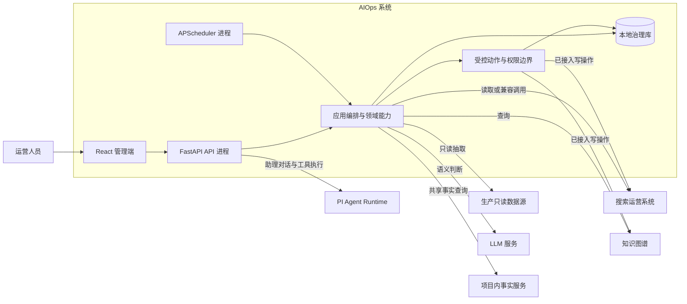

# 整体技术架构

| 字段 | 日期 |
| --- | --- |
| 创建时间 | 2026-07-23 |
| 最后更新时间 | 2026-08-31 |

## 1. 文档定位与系统边界

本文说明 AIOps 的系统边界、运行单元、逻辑分层、跨模块技术边界和关键架构决策，帮助开发者和 Agent 在改动前理解“哪些能力由谁负责、数据从哪里来、写操作如何受控”。

## 2. 系统上下文与运行时架构



### 2.1 运行单元

| 运行单元 | 当前职责 | 入口与代码映射 |
| --- | --- | --- |
| React 管理端 | 提供运营工作台、配置、日志、账号与智能助理界面；只经 HTTP API 访问系统能力。 | 启动入口 `frontend/src/main.tsx`；应用壳 `frontend/src/app/RootApp.tsx`；路由 `frontend/src/app/AppRouter.tsx`；`App.tsx` 保留兼容导出。 |
| FastAPI API 进程 | 提供认证、权限校验、品牌隔离、查询与动作确认接口，并编排领域能力。 | 对外稳定导入 `src.api:app`；应用装配 `src/api/app.py`。 |
| APScheduler 进程 | 独立执行定时治理、监测、追踪与恢复相关任务，不直接响应前端请求。 | 进程入口 `main.py`；实现入口 `src/scheduler/runner.py`。 |
| 本地治理库 | 保存治理状态、评分、动作事实、日志、配置和运行状态；测试环境使用 SQLite，生产环境使用 MySQL。 | `src/persistence/` 与 `src/migrations/`。 |

### 2.2 外部系统与数据边界

| 外部能力 | 使用方式 | 架构边界 |
| --- | --- | --- |
| 生产只读数据源 | 为 Top Query、品牌指标和 No Result 提供抽取数据。 | 只读；不承载本系统治理状态，也不作为写入目标。 |
| 搜索运营系统、知识图谱 | 通过适配层获取搜索、商品、KG 标签和关系等事实。 | 已接入的外部写操作须经过 ActionGateway；未接入或兼容期入口不能据此推断具备统一幂等、权威回读或终态事实。 |
| LLM 与外部服务 | 仅在需要语义判断时支持 Query 偏好、KG 和相关性等节点；共享天气、节日等事实由项目内事实服务提供。 | 确定性路由、计算、重试和格式转换由代码完成；外部服务不可用时按节点异常规则收口。 |
| PI Agent Runtime | 通过原生 RPC、Session 和工具执行智能运营助理任务。 | 负责助理任务规划与执行；不替代 Top Query 主治理 workflow 的确定性代码。 |

## 3. 逻辑分层与依赖方向

| 层级 | 主要职责 | 代码映射 |
| --- | --- | --- |
| 表现层 | 页面、路由、布局、交互和前端状态。 | `frontend/src/app/`、`frontend/src/features/`、`frontend/src/shared/` |
| API 与应用编排层 | HTTP 契约、依赖注入、认证入口和按业务域组织的用例编排。 | `src/api/app.py`、`src/api/routers/`、`src/api/application/` |
| 业务领域层 | 承载 Query 治理、No Result、智能助理、A/B 实验和独立断码任务的业务规则与 workflow。 | `src/query_governance/`、`src/no_result/`、`src/assistant/` |
| 跨模块治理层 | 为权限、动作授权、执行状态、回读和审计提供统一边界。 | `src/governance/` |
| 外部适配与 AI 能力层 | 隔离搜索运营、知识图谱、数据源、模型与配置的接入差异。 | `src/integrations/`、`src/llm/` |
| 数据与运行支撑层 | 管理治理库、Schema、调度、进程保护、通知和发布身份。 | `src/persistence/`、`src/migrations/`、`src/scheduler/`、`src/runtime/` |

依赖方向：

- 管理端只依赖 FastAPI 暴露的接口，不直接访问外部搜索、知识图谱或模型服务。
- API 进程和 Scheduler 进程共享领域能力，但分别承担同步请求与异步调度职责。
- 领域代码通过持久化层保存本地治理事实，通过外部适配层访问外部系统；需要语义判断时才使用模型或 MCP。
- 已接入的 mutation 由 ActionGateway 统一收口；具体路由分类以 `src/governance/write_entry_registry.py` 及其契约测试为准。

## 4. 关键横切链路

| 链路 | 主路径 | 系统保证与边界 |
| --- | --- | --- |
| 运营查询 | 管理端 → API → 应用编排 / 领域能力 → 本地治理库或外部适配 → API → 管理端 | 前端不直连外部系统；具体接口字段和缓存策略由接口与前端规范维护。 |
| 定时治理 | Scheduler → 领域 workflow → 本地治理库、生产只读源和外部适配 | Scheduler 是独立运行面；任务注册、锁、租约和恢复以调度文档为准。 |
| 受控写操作 | API → 权限与品牌范围校验 → ActionGateway → 外部适配 → 权威回读与动作事实 | 仅对已接入入口成立；兼容或未接入入口必须按其自身契约处理。 |
| AI 辅助 | 领域能力 → LLM / MCP；智能助理优先本地工具，再按需调用 PI Agent | 模型负责语义判断与生成，不承担确定性流程控制；具体提示词和工具范围属于模块设计。 |

## 5. 跨模块技术边界

### 5.1 数据所有权

- 生产只读数据源只提供抽取事实。
- 本地治理库是本系统治理状态、评分、动作、日志和配置的记录位置。
- 搜索运营和知识图谱中的外部变更必须以其权威回读结果为准，不能只依据请求已发送判断成功。

### 5.2 权限与受控动作

- 页面可见性由 `pagePermissions` 控制；真实数据和动作边界由 `brandPermissions` 与 `actionPermissions` 控制。
- `ActionGateway` 是跨模块受控写入的当前标准，为已接入操作提供授权、幂等、执行状态、权威回读和审计收口。
- ActionGateway 不是所有历史写入口已经统一迁移的证明；修改 mutation route 前必须核对 `src/governance/write_entry_registry.py` 及其契约测试。

### 5.3 外部适配与模型调用

- `src/integrations/` 承担外部系统接入差异，业务模块不应在前端或路由层直接拼接外部请求。
- `src/llm/` 管理模型客户端与节点配置；领域模块只在确有语义判断需求时调用模型。
- 智能助理由 PI Agent 统一编排本地事实查询和测试环境工具执行，具体权限与动作边界以[智能运营助理](features/03-智能运营助理.md)为准。

### 5.4 配置、运行与恢复

- 业务阈值、执行模式和品牌开关默认支持热更新；配置保存、重新加载和调度同步的实现以[调度与中间件](06-调度与中间件.md)为准。
- 调度状态、补跑、健康检查、未知结果和回滚边界以[运行、恢复与发布边界](07-兼容性灰度与运维.md)为准。

## 6. 关键架构决策

### 6.1 API 与 Scheduler 分离运行

API 服务同步管理端请求，Scheduler 执行异步治理任务；两者复用领域能力，但不互相承担对方的运行职责。

### 6.2 主治理链路与智能助理旁路分离

- Top Query 主治理采用 LangGraph 和本系统受控写入边界。
- 智能助理由 PI Agent 通过原生工具完成查询、诊断和测试环境执行；确定性治理主链仍由领域代码负责。
- Ops Team/专家排序不属于当前 Query 主链；相关旧服务、API、调度、页面和配置按退役范围清理，历史文档仅作参考。

### 6.3 生产只读源与本地治理库分离

业务抽取来自生产只读源；所有治理状态、评分、动作和日志均落本地治理库，避免对生产业务数据源产生治理写入依赖。

### 6.4 权限先于页面，写入先于回读闭环

页面可见不等于具备数据或动作权限。已接入的写操作必须先通过权限与动作治理，再以权威回读和动作事实收口。

### 6.5 配置热更新优先于重启

多数业务阈值、执行模式和品牌开关以热更新生效为默认，避免把常规运营调整变成服务重启。

### 6.6 不虚构当前不存在的基础设施

当前没有统一领域服务总线、统一命令总线、独立消息队列消费者或独立缓存服务。开发和 Agent 应以“API + Scheduler + 本地治理库 + 外部 HTTP 服务”为当前实现事实，不应假设额外基础设施已经存在。

## 7. 项目目录与代码映射

以下目录图用于快速定位代码，不替代模块设计、接口契约或数据存储设计。

```text
.
├── main.py                      # Scheduler 进程入口
├── src/                         # Python 后端包
│   ├── api/                     # FastAPI 应用装配与 HTTP 边界
│   │   ├── app.py               # 应用创建、生命周期和路由注册
│   │   ├── application/         # 按业务域组织的请求处理与用例编排
│   │   ├── routers/             # 稳定的路由模块导出
│   │   ├── contracts.py         # OpenAPI 契约安装
│   │   ├── dependencies.py      # 认证、权限等依赖注入
│   │   ├── lifecycle.py         # 启停与健康探针
│   │   └── shared.py            # API 层通用辅助
│   ├── assistant/               # 智能助理服务与本地工具
│   ├── governance/              # 跨域动作治理、身份、策略与写入口登记
│   ├── integrations/            # 搜索运营、知识图谱和数据源等外部适配
│   ├── llm/                     # 模型客户端、节点配置与语义 Agent
│   ├── migrations/              # Schema 迁移与发布前结构验证
│   ├── no_result/               # 无结果词治理领域与 workflow
│   ├── persistence/             # ORM 模型、会话、Schema 与仓储
│   ├── runtime/                 # 进程协调、通知与发布身份
│   ├── scheduler/               # 调度、恢复、可靠性与终止控制
│   ├── query_governance/        # 新 Query 治理主链与节点实现
│   ├── top_query/               # 旧 Top Query 实现，仅作历史参考
│   └── config.py                # 共享配置读取与热加载
├── frontend/
│   ├── e2e/                     # Playwright 浏览器端到端测试
│   ├── public/                  # 公开静态资源
│   └── src/
│       ├── app/                 # 应用壳、路由、布局、主题与鉴权入口
│       ├── features/            # 按业务域组织的页面、局部组件、Hook、类型和资源
│       │   ├── account/         # 账号与助理授权
│       │   ├── assistant/       # 智能助理
│       │   ├── auth/            # 登录
│       │   ├── config/          # 运营配置与 A/B 实验
│       │   ├── no-result/       # No Result 治理
│       │   ├── operations/      # 运营日志与库存任务
│       │   └── query-governance/ # Query 治理与品牌工作台
│       ├── shared/              # 跨 Feature 稳定复用的 API、类型、Hook、工具和 UI
│       ├── styles/              # 全局样式和设计 token
│       ├── test/
│       │   ├── setup.ts         # Vitest 全局测试环境
│       │   ├── architecture/    # 目录和测试归位守卫
│       │   └── integration/
│       │       └── mobile/      # 跨页面移动端 Vitest 集成测试
│       ├── testUtils/           # 可复用测试辅助与 fixture
│       ├── App.tsx              # 应用兼容入口
│       └── main.tsx             # Vite 启动入口
├── tests/                       # Python 后端单元、集成与契约测试
├── scripts/                     # 本地开发、CI 与发布工具
└── docs/                        # PRD、TSD、API、规范与发布文档
```

- 后端按照 HTTP 边界、业务领域、跨模块治理、外部适配与运行支撑拆分；领域规则、外部调用和持久化实现保持可区分的职责边界。
- 前端采用 Feature-first 结构：业务代码归入所属 Feature，应用级能力归入 `app/`，稳定跨 Feature 能力归入 `shared/`。
- 前端白屏防线：发布只保留新版哈希 chunk，旧标签页懒加载失效时由 `main.tsx` 安装的 `vite:preloadError` 守卫自动刷新一次（`app/chunkReloadGuard.ts`，带冷却窗口防刷新循环）；其余未捕获渲染异常由 `app/ErrorBoundary.tsx` 兜底为可恢复提示。会话失效（401）处理只按"请求 token 与当前本地 token 匹配"判定并同步清除本地态后广播 `search-ops:auth-expired`，不使用持久化去重标记，避免标记残留导致后续失效被静默跳过。
- 测试按被测范围归位：单元测试与代码共置，跨模块集成测试和浏览器端到端测试使用独立测试目录。

## 8. 与其他 TSD 文档的边界

- 需要理解业务主流程、状态机或模块内 workflow：阅读[02 业务流程与状态流转](02-业务流程与状态流转.md)和对应 `features/` 文档。
- 需要修改表、索引、迁移或数据事实：阅读[03 数据存储设计](03-数据存储设计.md)。
- 需要新增或修改 HTTP 接口、权限、动作契约：阅读[04 接口设计](04-接口设计.md)，并核对 `src/governance/write_entry_registry.py`。
- 需要修改 Query 治理、No Result、智能助理、A/B 实验或 Ops Team：从[05 功能模块设计索引](05-功能模块技术设计.md)进入对应模块文档。
- 需要调整任务、恢复、环境、发布或验证：阅读[06 调度与中间件](06-调度与中间件.md)、[07 运行、恢复与发布边界](07-兼容性灰度与运维.md)、[08 联调测试与规范](08-联调测试与规范.md)。
- 跨文档任务的阅读顺序与验证入口：使用[TSD 总纲的任务 Change Map](../TSD.md#6-任务-change-map)。
