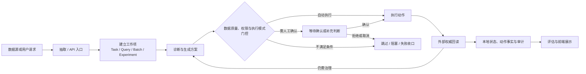
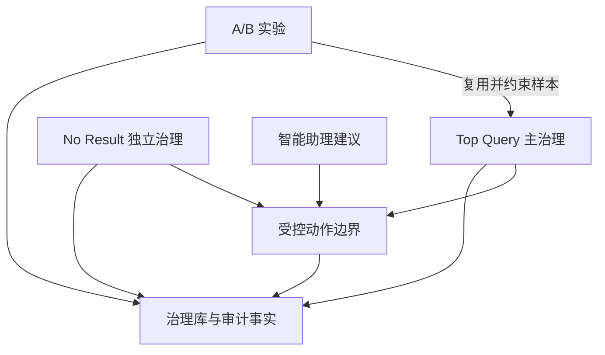

# 业务流程与状态流转

| 字段 | 日期 |
| --- | --- |
| 创建时间 | 2026-07-23 |
| 最后更新时间 | 2026-09-17 |

## 1. 文档定位

本文是 AIOps 的全局业务流程和状态索引，以便快速判断：

- 一个业务请求会进入哪条治理链路；
- 各模块之间如何衔接；
- 当前状态属于工作项、动作、Workflow 还是展示态；
- 需要继续阅读哪份模块文档、接口文档和验证文档。

本文不维护模块内部节点、提示词、预算算法、评分公式、表字段或完整接口清单。实现细节以对应模块文档和当前代码为准。

## 2. 全局业务闭环



## 3. 模块流程索引

| 模块 | 进入条件与工作项 | 全局流程中的位置 | 状态事实源 | 详细设计 |
| --- | --- | --- | --- | --- |
| Query 治理 | Scheduler 或 API 建立 Query 治理批次。 | 固定主链：提取 Query → Mixed 保存 S0 → 召回检查 → 排序治理 → 相关性检测 → 主链结束。 | `query_governance_task`、`query_governance_step_status`、`query_governance_workflow_run`、`query_governance_action_plan`。 | [Query 治理](features/01-Query治理.md) |
| No Result | 只读源抽取后建立 Batch 和 `NoResultQuery`。 | 独立治理链路：归一化去重 → 生成图谱方案 → 执行门控 → 串行执行 / 暂停 / 恢复 → 回读与 Retag。 | `NoResultGovernanceBatch`、`NoResultQuery`、`NoResultGovernanceAction`、RetagTask。 | [无结果词治理](features/02-无结果词治理.md) |
| 智能助理 | 用户选择单品牌后建立会话；自然语言请求可产生 `AssistantActionRequest`。 | AIOPS 鉴权 → PI Agent Session → 原生工具执行 → prepare / confirm / cancel。 | `AssistantSessionMeta`、`AssistantActionRequest`。 | [智能运营助理](features/03-智能运营助理.md) |
| Ops Team | 已退役。 | 不再属于 Query 治理主链或当前交付范围。 | 历史数据仅按数据库重构范围处理。 | [Ops Team 与排序协作（历史参考）](features/05-Ops-Team与排序协作.md) |
| A/B 实验 | 实验从 `draft` 排期并冻结 40 个样本。 | Top Query 的实验扩展：20 个实验组治理、20 个对照组观测、质量检查和效果计算。 | `TopQueryExperiment`、Sample、DailyMetric、实验组 Top Query 任务。 | [品牌 A/B 实验](features/04-品牌A-B实验.md) |

### 3.1 模块之间的衔接



## 4. 公共状态模型

不同模块的字段名称和可用状态并不完全一致。以下四个维度必须分开理解，不能互相替代。

| 状态维度 | 回答的问题 | 典型事实源 | 不应替代的维度 |
| --- | --- | --- | --- |
| 工作项状态 | 这个 Task、Query、Batch 或 Experiment 走到哪一步？ | 领域表的 `status`，如 `TopQueryTask`、`NoResultQuery`、`TopQueryExperiment`。 | 不能用展示态判断外部动作是否完成。 |
| 动作状态 | 某一次具体写入或建议处于什么阶段？ | ActionPlan、GovernanceAction、AssistantActionRequest 及其请求 ID。 | 不能用 Workflow 当前节点代替。 |
| Workflow / 运行状态 | 当前进程是否运行、暂停、恢复或持有 checkpoint？ | `top_query_workflow_run`、Scheduler run、lease 和 checkpoint。 | 不能直接等同于业务工作项完成。 |
| 展示状态 | 前端应该向运营人员呈现什么总体结论？ | API 聚合的节点状态、动作事实和异常说明。 | 不能作为权限或写入授权依据。 |

### 4.1 工作项状态

工作项状态由各模块自己拥有，不强行建立一个跨模块枚举：

- Top Query 节点只使用待执行、执行中、已执行、已跳过、异常；批次和 Query 的总体状态由节点状态聚合，不引入规划轮次或评估循环；
- No Result 需要区分 Query、Batch 和 RetagTask 的准备、执行中、暂停、待执行、待重新标记、完成、失败和人工处理；
- A/B 实验生命周期是 `draft → scheduled → running → ended`，草稿或排期状态还可以取消；每日质量异常属于运行结果，不等于实验生命周期结束；
- 已退役的 Ops Team 状态不再进入当前 Top Query 流程。

### 4.2 动作状态

动作状态表示一次具体动作，而不是整个工作项。不同模块可能使用不同字段，但概念上通常包含：

```text
建议或准备
→ 待执行 / 待人工确认
→ 执行中
→ 成功 / 已执行
→ 失败 / 未知结果 / 已取消 / 已被新动作替代
```

其中：

- `execution_unknown` 表示外部结果尚未确认，不能直接当作失败或成功；
- `manual_required`、`pending_confirmation`、`waiting_human_approval` 可能分别属于工作项、动作或展示层，必须先确认字段所有者；
- 已接入受控写操作必须经过权限、幂等、权威回读和终态事实收口。

Query 治理方案动作只写入以下标准状态：`pending`、`executing`、`verified`、`failed`、`execution_unknown`、`rollback_pending`、`rolled_back`、`rollback_failed`、`rejected`。旧的 `waiting_human_approval`、`pending_confirmation`、`approved`、`running`、`executed`、`completed`、`success`、`error`、`verification_failed` 不再作为 `query_governance_action_plan.status` 的合法写入值；其他工作项、节点或历史模块中同名状态由各自字段所有者管理，不在此处混删。

升级时一次性规范化旧自动重排序动作：`executed` 在原写入链路已完成权威回读，转为 `verified`；`error` 按原始 `response_json.verification.rollback.status` 和错误码区分 `rolled_back`、`rollback_failed`、`execution_unknown`、`failed`。它们统一记录已知的 `executor_type=ai_auto`，但旧数据无法精确证明实际执行时刻，`executed_at` 保持为空；运行时不提供旧状态别名兜底。

动作同时记录 `executor_type`、`executor_user_id`、`executed_at` 和 `failure_stage`：

- `executor_type=ai_auto` 表示 AI 生成或触发方案后由系统自动执行；
- `executor_type=human` 表示由人工触发执行；
- `failure_stage` 只记录 `generation`、`execution`、`verification` 或 `rollback`，用于解释失败原因，不生成额外展示状态。

### 4.3 Workflow 与恢复状态

Workflow 状态描述执行进程，而不是业务结论。发生重启、租约转移或 checkpoint 恢复时，优先读取持久化的安全节点和版本，不应默认从头执行。

详细的 checkpoint、lease、预算、暂停、未知结果和恢复规则见[调度与中间件](06-调度与中间件.md)及[运行、恢复与发布边界](07-兼容性灰度与运维.md)。

### 4.4 展示状态

展示态是 API 面向前端的聚合结果，可能综合工作项、步骤、动作和评估事实。它用于帮助运营人员理解结果，不是后端状态机，也不是写操作授权依据。

治理方案固定展示“待执行、执行中、AI 已执行、手动已执行、AI 执行失败、手动执行失败、结果待确认、回滚中、已回滚、回滚失败、已取消”十一种状态。`verified` 和 `failed` 必须结合实际执行来源生成文案；`execution_unknown` 不得降级为执行失败；`rollback_failed` 不得混入普通执行失败。

## 5. 公共流程门控与终态语义

所有需要改变外部或本地治理状态的流程，都应明确经过以下门控：

| 门控 | 作用 | 未通过时的语义 |
| --- | --- | --- |
| 数据质量 | 确认抽取数据、样本、快照和基线足以继续。 | 缺数据、错配或污染时进入异常 / 阻塞，不补造正常结果。 |
| 权限与品牌范围 | 确认用户、品牌、对象和动作权限。 | 拒绝或转人工，不以页面可见替代真实权限。 |
| 执行模式 | 区分 disabled、human approval、auto 或模块自身的风险门控。 | 跳过、待确认或待执行，不伪装成已执行。 |
| 外部执行 | 使用稳定请求身份调用外部系统。 | 明确失败或未知结果，保留动作事实。 |
| 权威回读 | 从外部系统确认最终状态并写入本地事实。 | 不能仅凭 HTTP 请求成功结束流程。 |
| 事实与展示 | 根据节点、动作和回读事实生成运营结论。 | 质量异常时保留异常证据，不用 0 或默认值掩盖缺失。 |

终态语义统一遵循：

- `completed / succeeded`：对应的工作项或动作已达到其定义的完成条件；
- `failed`：流程或动作明确失败；
- `execution_unknown`：外部结果未确认，需要查询或人工处理；
- `manual_required / pending_confirmation`：等待人类决策，不等于系统失败；
- `skipped / superseded / cancelled`：流程未继续，但原因和替代关系必须可追溯。
