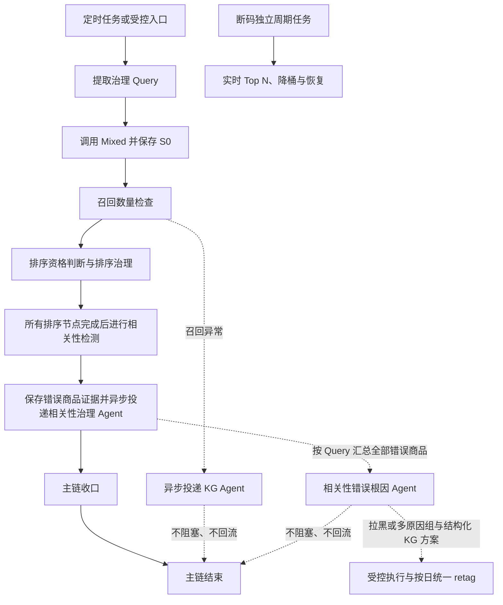

# Query 治理

| 字段 | 日期 |
| --- | --- |
| 创建时间 | 2026-07-23 |
| 最后更新时间 | 2026-10-19 |

节点模型配置的 `resolve_node_config` 不按模型能力白名单拦截主/备模型名称，草稿保存、发布和运行时快照读取共用此规则。保留模型名非空、长度、空白/控制字符、主备不同及节点/通道校验；`requiredCapabilities` 仅描述节点输入需求，供页面展示。模型图文能力由配置人员确认。

## 1. 模块定位与边界

Query 治理负责按固定顺序完成每日 Query 的召回检查、排序治理和相关性检测，并记录节点结果、治理动作和验证事实。除每日主链外，系统提供独立的手工相关性检测接口，供调用方按品牌、Query 和 SKU 批量检查商品是否符合检索意图。

手工相关性检测使用 `POST /api/query-governance/relevance-checks` 提交任务、`GET /api/query-governance/relevance-checks/{check_id}` 读取结果，并可通过 `GET /api/query-governance/relevance-checks/latest` 按品牌和 Query 读取最近一次结果。服务端按 SKU 调用商品详情业务接口，补全商品名称、图片、品类、描述等字段，随后复用现有图文 Prompt、图片准备、模型运行时和结果解析；Query/SKU 数量不作为 API 限制，内部按相关性运行配置分片。该边界不读取历史相关性记录，不写入相关性记录，不生成拉黑、KG、治理动作或治理时间线，仅持久化任务状态与返回结果。相关性治理方案的“纠正验证”入口复用该异步边界，按钮回显执行中状态，按钮下方展示最近验证时间，结果弹窗按错误商品、正确商品顺序展示。

## 可观测性耗时口径（AIOPS-230）

- `durationSeconds` 保留为历史节点墙钟耗时，不能直接解释为单 Query 独立模型耗时。
- Query telemetry 同时提供 `endToEndSeconds`（任务端到端墙钟）、`nodeWallClockSeconds`（节点墙钟累计）和 `independentProcessingSeconds`（已采集到的非共享节点执行时间）。批量相关性模型耗时属于共享时间，不写入每个 Query 的独立处理时间。
- 批次 telemetry 提供 Query 端到端时间和独立处理时间的 `averageSeconds`、`p50Seconds`、`p95Seconds`，以及批次墙钟、唯一批次模型耗时 `modelSeconds`、动作耗时 `actionSeconds` 和复检耗时 `recheckSeconds`；模型调用、重试、图片成功/失败和并发等无法从历史数据可靠推导时返回 `null`。
- 批次 telemetry 的 `irrelevantProductCount` 统计不相关商品数，`irrelevantQueryCount` 按 Query 去重统计至少检测出一个不相关商品的 Query 数；品牌总览卡展示后者，详情以“错误商品”展示前者用于商品级准确率与比例。
- 批次 telemetry 的 `topQueryLimit` 读取批次配置快照中的 `extract_limit`，表示 Top Query 取词上限；`rapidPvGrowthQueryCount` 统计已选候选中命中 `rapid_pv_growth` 规则的 Query 数，详情分别展示为“Top Query”和“快速增长”。
- 相关性批量模型调用记录批次键、批次 Query 数、模型调用时间、重试次数、图片准备耗时和轮次耗时；Query 轮次还记录动作与复检耗时。这些指标只用于性能观测，不改变治理结果、checkpoint 或动作持久化语义。

Langfuse Core 兼容回调在上报 generation 前将 LangChain 消息转换为 OpenAI 兼容的 `role/content` 字典。单组会话直接保存消息数组，多组调用保留各组边界；system、user、assistant、tool 角色及图片和工具调用结构先标准化，再通过既有脱敏函数过滤凭据与 base64。转换失败仅记录 warning 并回退原输入，不影响模型调用；该格式只作用于新记录，不回填历史 Trace。

- 主链不使用动态规划或评估循环，固定为：`S0 → 排序治理 → 相关性检测 → 召回检查（召回率检测与补全 + 召回数量检查） → 主链结束`。
- 断码是独立周期任务，仍在 Query 治理页面展示，但不进入主链。
- 价格异常检查已退役，主链不再执行价格判断或价格降桶。
- A/B Test 是主链的实验扩展：实验组执行完整治理，对照组只记录自然数据变化，不执行治理动作。
- 旧实现目录只作为业务规则和外部接口调用的历史参考；当前实现位于 `src/query_governance/`。

## 2. 主链流程

### Token 用量口径

- 相关性结果保留 `modelCallAudits`：每次真实模型调用的 `requestId`、`tokenUsage` 和 `batchQueryCount`。多轮检测累计保存，空数组表示没有模型调用；历史缺字段不能视为零消耗。
- Query 的 `telemetry.tokenUsage` 与 `relevanceTokenUsage` 按调用的 `batchQueryCount` 均摊；新记录保留小数（最多三位），品牌/批次总量按全局唯一 `requestId` 去重，兼容历史 `audit` 和 `preference_audit`。
- 总量正常展示已知用量合计。缺失发生在哪个 Query，由 `tokenUsageMissing` 与 `relevanceTokenUsageMissing` 指示；同一 Query 部分调用缺失时，保留已知合计并标记缺失，不把缺失值伪造为零。相关性完全未知时 `relevanceTokenUsage` 为 `null`，明确无调用时为 `0`。
- 原始用量提取、失败/降级调用保存和读取统计遵循同一链路；前端 Query 列表展示总 Token、相关性 Token 和缺失标签。历史用量不回填，不从文本长度估算实际消耗。

- 同一品牌一个监测周期只建立一个主链批次，按阶段批量推进。
- 单个 Query 或节点异常只记录本身的异常，不阻塞其他 Query 或后续节点。
- 每个节点完成后立即保存状态；任务中断时从第一个未完成节点继续，已完成节点不重复执行。
- 外部动作必须经过权限、幂等、审计、权威回读和必要的回滚；排序回验按目标坑位逐项比较，部分命中视为成功，只有零命中才回滚。Mixed 读取异常属于结果待确认，保留外部配置并记录 `ACTION_READBACK_INCONCLUSIVE`，继续后续 Query。

## 3. 节点职责

| 节点 | 处理内容 | 主要结果 |
| --- | --- | --- |
| `s0` | 对每个 Query 调用一次 Mixed，保存治理前商品最小快照。 | `S0` 只供前端治理前展示和召回检查，首次成功写入后不可覆盖。 |
| `reorder` | 只处理 CTR/CVR 下降达到配置阈值的 Query；生成偏好、调用向量重排并自动写入排序。向量接口遇到超时、连接异常、429/5xx 或空结果时，按品牌配置进行有限次数的指数退避重试；仍失败才结束当前 Query。 | 执行、跳过或异常；写入后 Mixed 回读验证。目标坑位至少命中 1 个即确认成功，记录命中数/目标数；全部未命中才回滚。Mixed 无法读取时标记“结果待确认”，保留外部配置，不回滚。向量调用记录实际尝试次数，便于区分瞬时失败与稳定无结果。 |
| `relevance` | 每个 Query 重新调用 Mixed，先按既有 Top N 截取，再按相关性检测分桶配置过滤，复用当前 Query 已通过商品记录，对剩余商品提交图文多模态检测。 | 相关、错误商品、图片警告或异常；已判定不相关的商品先按 Agent 与拉黑工具的最严格模式独立处理，再按 Query 异步投递根因分析，生成 KG 调整方案或人工复核结论。 |
| `recall` | 双路召回率检测受品牌级开关 `query_governance_recall_rate_enabled` 控制（默认关闭；商品目录数据源 `PRODUCT_DB_*` 未配置时自动复用取词的 `RD_RDS_*` 只读凭据，两者都缺失时在证据中提示不可用）。启用时在相关性拉黑后执行双路召回率检测（Mixed 搜索召回 vs LLM 全量目录召回）：两路交集商品直接写入相关性通过记录；LLM 单独召回商品完全复用相关性检测模块判定并双向共享通过缓存；通过相关性检测的 LLM 增量商品结合 Mixed 分词 `tags`（0 个词走白名单、1 个词直接打白名单标签、多词经 JEV 模型筛选打白名单标签）生成补召回动作：加白名单标签（含重打标）与加 Query 白名单两个动作分别由 `top_query_tool_modes.whitelist_tag` / `top_query_tool_modes.query_whitelist` 控制执行模式（auto 经动作网关幂等执行并落审计计划；human_approval 落待审批计划，由 Query 详情治理方案区人工执行 `/api/query-governance/actions/{id}/execute`；disabled 仅记录）。仅已执行的动作触发 Mixed 复检（复检召回率是否达 100%）；待审批动作提示运营审批后自动生效。数量检查（少结果/骤降）不受开关影响，基于补全后的最新召回数量执行。 | 持久化召回率、打标动作（含执行模式与计划 ID）、待审批数量、未召回商品提示、当前数量、前一日数量与对比结论；数量仍异常时异步投递 KG Agent。 |

商品图片由相关性服务下载、转码并缓存到对象存储后再提交模型。若运行环境无法直接访问品牌 CDN，可通过 Kubernetes Secret 注入环境变量
`QUERY_GOVERNANCE_IMAGE_PROXY_URL`，为 Backend、Scheduler 和手工相关性检查配置 HTTP(S) 代理出口；未配置时使用直连。
当前生产 NetworkPolicy 只允许这两个工作负载访问 TCP 443 和 DNS，因此生产代理需使用可从 Pod 访问的 443 端口；代理值不得写入代码、镜像、日志或命令行。

图片输出仍限制最长边 768 像素。JPEG 在 `load()` 前使用 Pillow `draft()` 缩略解码；所有 transformer 实例共用最多两路转换信号量。解码前像素预算为 1600 万，PNG 等不支持缩略解码的超预算图片返回 `IMAGE_PIXEL_LIMIT_EXCEEDED`，不将缺图视为检测通过。压缩文件字节限制与解码像素预算分别检查，最终 OSS 图片大小不能代表原图解码峰值。

世界事实、品牌信息和社媒趋势属于排序节点输入。单个事实缺失记录警告并使用其他事实；全部事实缺失时排序节点异常，但主链继续相关性检测。

偏好生成模型按完整 Query 分组批量调用。品牌级配置 `query_governance_preference_generation_batch_query_limit` 控制单次请求最多包含的 Query 数量，默认 `10`；`query_governance_preference_generation_timeout_seconds` 控制单次模型请求超时，默认 `600` 秒（10 分钟）；`query_governance_preference_generation_concurrency` 控制批次并发数。配置页保存后热加载，仅影响后续新任务。

## 4. 快照、实时结果与状态

- `S0` 保存商品 ID、排序、名称、图片、原价、折扣价和快照元数据。
- 节点出现可重试的 Mixed 或模型输出错误时，恢复只重开该失败节点，保留同批次已完成节点结果；不可重试错误保留为终态并进入人工定位。
- 主动分段恢复通过 checkpoint payload 的 `invocation_yielded` 区分：CAS 消费该标记时不重开已失败节点，先推进剩余待执行 Query；意外中断仍执行既有可重试错误恢复。无需数据库迁移。分段上限及调度互斥见[调度与中间件](../06-调度与中间件.md)。
- 前端治理前商品始终读取 `S0`；前端当前商品结果读取实时搜索。
- 结果数量卡片和详情结论读取召回节点执行时持久化的事实，不使用页面实时 Mixed 结果覆盖。详情字段为当前结果数量、往期召回数和对比结果；前一日缺失时按正常回显，不展示历史样本不足。
- 排序或拉黑改变结果后重新调用 Mixed，只把新进入 Top N 且没有当前 Query 通过记录的商品加入后续检测；不重复检测已处理商品。
- 相关性检测分桶配置 `query_governance_relevance_buckets` 保存 Mixed 返回的稳定 bucket ID，配置页使用带业务层级编号的中文名称回显：`top` 为 L0-1 置顶桶，`productIdsByAgent` 为 L0-2 Agent 选品；现有六个 L1/L2 叶子分桶保持原编号；其余普通叶子分桶按当前展示顺序依次标为 L3-1 至 L3-9；`productIdsByNoStock` 为 L4 无库存桶；`Dynamic`（动态召回）是独立分桶，不使用 L 编号。默认检测六个 L1/L2 分桶，也支持追加其他已定义分桶，包括独立的 `Dynamic`。Atlas 配置额外启用 `Dynamic`，全局默认仍保持六个 L1/L2 分桶。每次 Mixed 返回后先截取 `top_query_check_product_limit` 前 N 个；选择全部已知分桶时表示不按 bucket 过滤，缺失或未知 bucket 的商品也进入相关性检测，兼容没有分桶体系的品牌；部分选择时仍只保留命中的 bucket 商品。
- 每日选择批次冻结四个检查项的有效开关，配置修改记录只供服务端按治理日期解析，不向前端展示版本。读取 Query 列表、详情和品牌日期数据时，服务端返回可见检查项；关闭开关且日期内没有执行事实时隐藏，历史执行事实和断码恢复事实保留。断码关闭后不新增巡检/降桶，但继续处理关闭前已建立的恢复监测任务。
- Query 详情时间线把 `s0` 数量事实与 `recall` 判断合并为单一 `recall` 展示节点，名称为“召回数量”，并附带 S0 商品快照和 L1/L2 统计；底层确定性主链、checkpoint 与节点表仍保留 `s0 → recall` 两个执行屏障。
- Agent 事件展示前先将带命名空间的 `node_key` 归一到主节点。偏好结果存在但事件缺失时，由 `reorder` 持久化结果补出“偏好生成 Agent”子节点；向量调用事件只挂在重排序下。相关性节点按真实结果生成检测数量、逐商品结论、错误商品候选和相关性错误根因 Agent 子节点；拉黑动作在检测判定不相关后独立由受控网关形成，不为缺失数据生成虚假记录。
- 时间线详情传递原始输入输出作为非默认展示元数据；前端默认按中文字段、状态标签、列表和商品卡片渲染，原始 JSON 仅在“查看原始数据”折叠项展开。错误商品从 S0 快照补全可用字段，并展示已拉黑、待拉黑、拉黑失败及失败原因。
- 不保存或读取旧 `S1` 工作快照，不使用旧快照覆盖或版本失效判断。
- 节点状态只使用：待执行、执行中、已执行、已跳过、异常。异常必须带错误码、错误说明和耗时。
- 前端检查项展示状态固定为：异常、待处理、未执行、需关注、正常；一种状态对应一个标签和一种颜色，断码记录作为独立周期记录展示。
- 断码独立周期任务成功完成一轮巡检后，该批次每个实际参与巡检的 Query 都展示“断码”节点；节点结果为 0 个断码商品时仍展示为已执行，并回显最近巡检时间。只有没有成功巡检事实时才隐藏该节点。
- 断码降桶仍走权威 Query 降桶链路（动作分组、回读与对账锚定 `top_query_action_plan.task_id`）。治理主链迁移到 `query_governance_task` 后旧 `top_query_task` 不再产生新行：巡检发现的 Query 若只存在于当前治理管线，降桶前按最新匹配的治理任务补建完成态锚点 `top_query_task` 行；两边都没有任务时继续拒绝降桶。
- 治理方案动作状态与节点状态分离。动作只使用 `pending`、`executing`、`verified`、`failed`、`execution_unknown`、`rollback_pending`、`rolled_back`、`rollback_failed`、`rejected`，并通过实际执行来源区分“AI 已执行/手动已执行”和“AI 执行失败/手动执行失败”。失败阶段作为详情字段展示，不扩展状态数量。
- 读取 Query 列表和详情时，从该 Query 的动作计划及异步 Agent 任务投影各检查项的 `governanceStatus`（状态、标签、错误码与原因）；异步任务已有对应持久化方案时以方案为准。左侧检查项和执行概览共用同一状态模型，按异常（红）> 待处理（黄）> 未执行（灰）> 需关注（蓝）> 正常（绿）的严重度取第一条命中；治理已回滚或被拒绝时按问题证据判定（有证据为需关注，无证据为正常）。执行概览分别展示节点状态和治理方案状态，不把异步生成失败写成节点执行失败。

### 相关性检测 Prompt

单 Query、跨 Query 批量及手工检测共用 `relevance.py` 的 `RELEVANCE_SYSTEM_PROMPT`，使用综合图文判断；文本负责材质、功能等不可见属性，图片补充视觉特征，不要求两种证据各自通过。沿用品牌原始字段，不将系统推断的 dimensions 或标签加入检测证据。Query 纠正规则仍按 Query 追加，批量重试只追加格式纠错约束；输出仍为按商品顺序对齐的 `relevant`、`image_checked` 和不相关原因，不新增字段。Prompt 更新不清除已有通过记录、不回放历史结果，也不改变拉黑执行模式。

## 5. 异步 Agent、结构化动作与验证

召回异常仍创建原有异步 KG Agent 任务。相关性错误商品使用独立的“相关性错误根因 Agent”：工作流将同一 Query 下全部错误商品一次投递，Agent 在商品集合内输出多个原因组。全部已判定不相关商品先独立处理拉黑；个例组只保留根因结论，KG 问题组各自生成独立方案，证据不足组只影响根因人工确认。该 Agent 不以拉黑比例为触发门槛，不阻塞主链，也不回流重跑主链。

根因 Agent 编排的输入包含品牌、Query、Query 分词与已有 KG 标签、全部错误商品的完整详情和当前标签、相关性检测原因，以及 Query 标签自身信息、作为关系起点和终点的关联标签与关系类型。商品详情先通过商品列表获得内部商品记录 `id`，再读取商品标签和推理信息；不得以 `productId`、`spu` 或 `taggingUid` 替代该 `id`。工作流在单 Query 和跨 Query 批量检测两条路径复用同一独立动作处理：检测候选直接进入受控拉黑网关，之后投递根因任务，即使拉黑失败也继续分析；KG 分析失败不会阻断拉黑。checkpoint 在写入前保存检测证据；中断恢复先权威回读，不重新检测或重复写入，补投幂等根因任务。根因 Agent 不再生成或执行拉黑动作。

KG 问题组输出结构化动作计划，不以一句自然语言建议代替可执行参数。每套计划持久化原因组 ID、商品 ID 列表、标题、有序动作、参数、依赖步骤、风险等级和回滚方案。支持的动作映射为固定执行器能力：创建/更新标签、合成词、二次分词、谐音、新增/更新/删除标签关系。执行器在写入前校验当前 KG 状态、参数和步骤依赖，逐步记录幂等键和审计事件，写入后权威回读，并保存回滚所需的前置事实。

`strictest_execution_mode` 按 `disabled > human_approval > auto` 合并 Agent 与工具模式（旧 `dry_run` 等价确认模式）；未知模式拒绝执行。拉黑合并相关性与 `product_blacklist`，KG 按任务来源合并相关性或召回 Agent 与该组全部标签/关系工具；有效模式随计划持久化。`auto` 模式在单个原因组方案生成后立即调用固定执行器，不等待其他 Query 的方案生成。`human_approval` 模式为每套方案提供独立“一键执行”，确认后进入相同执行器。动作状态复用[统一状态与动作契约](../../prd/统一状态与动作契约.md)。

KG 调整执行与商品重新打标签解耦。调度器按“品牌 + 治理日”汇总该日所有 Query 的 KG 动作；待需执行动作全部进入已执行、已取消或明确失败等终态后，同一品牌治理日最多触发一次全量 retag。retag 触发后计划 30 分钟后重新读取召回结果，验证错误商品是否消失、正确商品是否误伤，并持久化验证前后召回数量和结论。

KG Agent 只生成方案，不在模型调用阶段执行写入。Agent 通过受控只读工具主动查询 KG 标签、关系、维度和商品搜索真实结果，工具调用证据随方案持久化；查询失败或未读完分页时不得将模型臆测当作查询结果。

双 Agent 边界：KG Agent 只处理召回数量异常；相关性治理 Agent 独立分析错误商品根因，读取商品详情和当前标签，输出完整 KG 参数或人工复核结论，不调用 KG Agent，也不生成或执行商品拉黑。两个 Agent 分别使用独立 Prompt、模型节点和 Langfuse Agent observation；只共用异步任务、动作审计、受控执行与回读基础设施。历史方案格式见[双 Agent 实施方案](../../query_governance_dual_agent_plan.md)，当前执行边界以本节为准。

Agent 的候选标签必须来自固定分词或原始 Query 内的相邻连续字符串，禁止跨字段拼接和凭空造词。方案决策为 `adjust`、`no_change` 或 `manual_review`：缺少搜索能力、查询失败或证据不完整时只能进入人工复核；`no_change` 必须回显 Agent 理由、标签/关系查询和搜索结果数。

对 `adjust` 方案，治理方案页签提供一键执行入口。执行器负责权限、幂等、执行前图谱冲突检查、KG 写入、写后权威回读和状态落库；执行失败或冲突不会显示为成功。MCP 发布和商品供给能力仍是独立 issue，不在本链路内假设已就绪。

读取详情时将已生成方案转换为逐条展示项；允许的关系名称仅为知识图谱契约中的“同义”和“从属”。涉及标签使用 Mixed 按标签名查询实时总数；`add_tag` 目标固定显示“待创建”，查询失败时显示未获取，不伪造数量。KG 任务成功、失败或待确认状态不改变结果数量卡片结论。

相关性治理按 `causeGroups` 渲染“策略 N → 结构化步骤 → 错误商品（本组数量）→ 本组商品卡片”，不再展示总错误商品标题或将所有商品汇总在策略末尾。KG 状态和“一键执行”放在策略标题右侧，执行继续通过原动作 ID 与 `groupId` 进入受控执行器；批量拉黑和纠正验证放在本组商品标题右侧，输入限定为本组商品。未生成动作的 KG 原因组显示“需人工复核”，个例只展示“个例，需拉黑”。已有原因组覆盖的商品从独立拉黑列表移除，未覆盖商品保留；组内商品回填独立动作的名称、图片与拉黑状态。商品卡片状态与 KG 执行状态独立。

相关性分组统一读取当前任务最新异步分析轮次，同轮已有持久化动作时优先使用动作方案及执行身份；治理方案和执行概览采用同一来源，检测阶段的初始 uncertain 分组不作为最终策略。前端合并 products、affectedProducts 与 productIds（含 snake_case），按原因组顺序分配唯一 SPU 归属；先处理全部明确组，再将尚未覆盖的候选商品置于人工复核组。策略在 Query 内连续编号，商品数量按本组去重结果统计。策略正文不渲染分组 `reasons` 和 `conclusion`，只展示结构化 KG 动作、个例拉黑或人工复核提示；错误原因由商品卡片展示，接口中的诊断字段继续保留。独立拉黑动作提供商品信息、最新状态和操作身份，不额外重复展示候选列表；尚无原因组的真实独立拉黑动作沿用个例语义。

`KGActionSteps` 从动作类型与真实参数确定性生成编号步骤；从属、同义、互斥使用已知关系 ID，不由缺失字段猜测。支持当前 `add_tag/update_tag/add_relationship/update_relationship/delete_relationship` 契约，不增加 `delete_tag`。只读投影 `_kg_steps` 保留 `actionType/params/dependsOn`，旧纯文本步骤兼容显示。

标签按钮打开 `KGTagDetailModal`，仅显示 `name/viewTag/isRoot/dimensions/weight/isEnglish/segmentingAgain/isCompose/nameAnd/nameNot` 十项；`isEnglish` 展示为英文分词、`segmentingAgain` 为二次分词、`isCompose` 为合成词。创建/更新动作展示拟提交参数，后续关系引用本策略新建标签时复用前序创建参数，其余标签按名称调用品牌受权只读接口。只有关系 ID 的更新/删除步骤通过只读 snapshot 查询精确关系并补齐展示名；属性或关系读取失败提供重试，异步过期响应不覆盖当前选择。UI 不提交或修改展示补齐后的动作参数。

商品单件/批量操作与纠正规则追加沿用原受控写入、审计和权威回读；retag 与延迟验证结果仍位于执行概览，不纳入 KG 步骤。相关性规则只来自用户手动填写：规则管理页保存、追加单条规则，或纠正弹窗“纠正并取消拉黑”提交的 `correctionRule`（在取消动作的本地事务内原子写入）。取消拉黑请求里的 `reason` 只写 `query_governance_relevance_guidance_reason` 审计记录，供页面查看，不再派生规则；批量取消拉黑也不写规则。

相关性规则追加和覆盖保存前，服务层过滤 Unicode 补充平面字符及孤立代理码位，兼容仍使用 MySQL 三字节 `utf8` 的规则表。过滤后的追加规则为空时返回 400；去重和长度校验基于过滤后的内容执行。

## 6. 实现定位

| 范围 | 入口 |
| --- | --- |
| 主链与节点推进 | `src/query_governance/workflow.py` |
| 状态、Checkpoint 与快照 | `src/query_governance/state.py`、`checkpoint.py`、`snapshot.py` |
| KG Agent、相关性错误根因 Agent、结构化 KG 执行器与异步任务 | `src/query_governance/kg_agent.py`、`kg_execution.py`、`async_tasks.py` |
| 共享事实、行为证据和适配器 | `src/query_governance/context.py`、`behavior_evidence.py`、`product_adapter.py` |
| 读取 API | `src/api/application/query_governance.py`、`src/query_governance/read_api.py` |
| 前端页面与类型 | `frontend/src/features/query-governance/`、`frontend/src/shared/types/index.ts` |

KG 原因组人工执行入口为 `POST /api/query-governance/actions/{action_id}/execute`，请求体使用 `groupId` 定位原因组；执行器统一经过 ActionGateway，按动作参数调用知识图谱客户端，写后回读并将执行人、状态、错误阶段和执行事实写回原 KG 方案。自动模式在单个原因组方案生成后直接调用同一执行器；批次 retag 仍由品牌+治理日调度器统一触发。

旧 Planner、Evaluator、旧 Agent Loop、价格节点、健康评分和 Ops Team 排序不属于当前 Query 治理主链；对应旧文档仅作历史参考，不作为实现依据。

### 相关性 KG 策略校验与失败留痕

`RelevanceGovernanceAgent` 通过专用 PI Runtime HTTP 入口运行错误商品治理，提交任务快照中的模型配置、独立 System Prompt、完整六类动作 JSON Schema、品牌场景和错误商品。PI 仅注册允许的只读 MCP 工具，限制调用次数和总超时，不复用助理会话、Shell 或写工具。MCP Token 只在服务端环境变量 `KG_AGENT_MCP_TOKEN` 保存，不进入 Prompt、前端、日志或 Git；地址由 `KG_AGENT_MCP_URL` 配置。图谱没有独立 STG 场景时，AIOPS 可信场景配置的 `sceneId` 绑定到任务，MCP 负责商品、标签、关系和维度读取。召回 Agent 仍使用原有实现。

品牌运营参考由当前品牌业务配置读取，首次使用独立默认案例，已保存空字符串不回填默认。参考在每次新任务开始注入 Prompt；仅保存当前内容、修改人、修改时间。

PI 返回原始策略及结构化查询证据，图谱查询转换为既有 `query_tag/query_relationship/query_dimension` 证据格式，保留查询失败和完整性。Python 校验完整 Schema、商品恰好覆盖一次、步骤依赖和图谱身份；合法策略仍交现有计划存储和 ActionGateway 执行。无效输出保留原始动作、校验错误和工具记录，不调用额外模型修复，不补充业务字段。图谱写入后权威回读和 @step 节点 ID 解析沿用现有执行器。

策略保存超过 60,000 字节时，先省略重复工具证据；仍超限则省略 v2 图谱上下文的查询结果行，保留每次查询的名称、参数和完整结果摘要，并标记 `resultsOmitted`。动作与分组不裁剪。执行前仍逐条重放原查询、核对完整图谱摘要并校验动作；图谱变化继续返回 `KG_PLAN_CONFLICT`。压缩后仍超限则明确返回 `KG_PLAN_TOO_LARGE`，不得保存不完整的可执行策略。

读取 API 和前端将失败/空动作 KG 组展示为人工复核，并显示校验失败原因；执行器选择指定组后不再回退执行整份计划的动作。商品拉黑与上述链路保持独立；部署后必须以新根因任务和治理后重新搜索验证实际效果。

### PI 生产运行保障

生产 Backend/Scheduler 随同一不可变镜像发布 PI sidecar，明确配置 loopback 地址与
Secret 内部认证；PI 仅接收 KG MCP 凭据，无数据库访问凭据。部署探针与发布回读
包含 PI 健康和镜像身份，策略生成仍需真实 MCP 业务验收。
`PI_RUNTIME_UNAVAILABLE/TIMEOUT/AUTH_FAILED/HTTP_FAILED/TRANSPORT_FAILED` 与
`PI_OUTPUT_INVALID` 分别留存到异步任务，避免连接错误被误读成模型格式错误。

MCP 商品详情按 SPU 查询，分页上限为 100；搜索工具保留前 10 件样本及上游总量，避免用大量搜索结果替代商品详情并耗尽模型上下文。标签、关系、维度查询仍读全分页。PI 最后一条模型消息以 `length/error/aborted` 退出或没有最终文本时，任务明确失败，不以空 JSON 生成“人工复核”方案。
